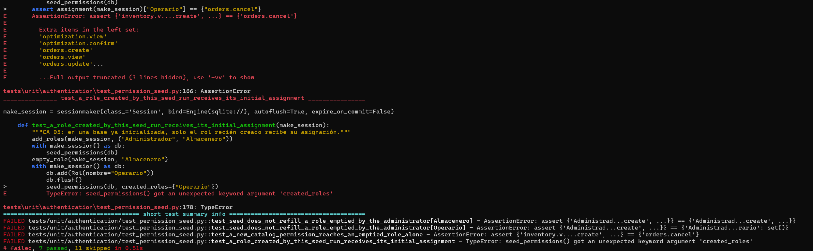
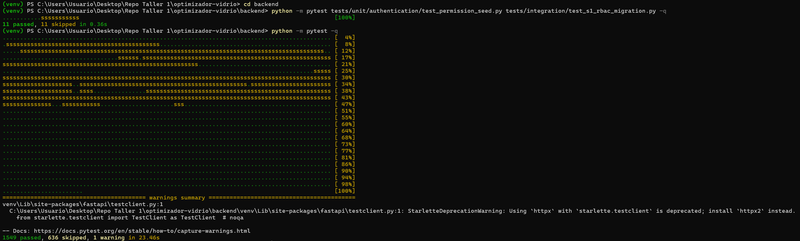

# Evidencia TA-039 — Seed de permisos: preservar roles deliberadamente vacíos

| Campo | Valor |
|---|---|
| PBI / tarea | TA-039 / T01 |
| SPEC | [SPEC-TA-039-seed-permisos-roles-vacios.md](../../../specs/SPEC-TA-039-seed-permisos-roles-vacios.md) |
| Origen | Auditoría pre-Sprint 2, hallazgo S1-06 (HIGH) |
| Rama | `fix/TA-039-seed-roles-vacios`, desde `integration/sprint-01` en `2fc228d` |
| Responsable | Fabricio Aguilar |
| Fecha | 27/10/2026 (America/Lima) |

## Commits

| Commit | Contenido |
|---|---|
| `1013523` | `docs(TA-039)`: SPEC con el análisis, las alternativas y las reglas |
| `d129bc3` | `test(TA-039)`: regresiones que reproducen el defecto (en rojo) |
| `fix(TA-039)` | Corrección en `permission_seed.py` y `seed.py` |
| `docs(TA-039)` | SPEC en Implemented y esta evidencia |

## 1. Antes de la corrección (rojo)

Sobre `d129bc3`, con el código original:

```text
python -m pytest tests/unit/authentication/test_permission_seed.py tests/integration/test_s1_rbac_migration.py -q
4 failed, 7 passed, 11 skipped
```



| Prueba | Resultado | Qué demuestra |
|---|---|---|
| `test_seed_does_not_refill_a_role_emptied_by_the_administrator[Almacenero]` | FAIL | El Almacenero vaciado recuperó `inventory.manage`, `inventory.view` y `optimization.view`. |
| `test_seed_does_not_refill_a_role_emptied_by_the_administrator[Operario]` | FAIL | El Operario vaciado recuperó sus 8 permisos, incluido `optimization.confirm` (descuenta stock). |
| `test_a_new_catalog_permission_reaches_an_emptied_role_alone` | FAIL | Ante un permiso nuevo, el rol vacío recibió toda su asignación, no solo el permiso nuevo. |
| `test_a_role_created_by_this_seed_run_receives_its_initial_assignment` | FAIL (`TypeError`) | La función no tenía forma de saber qué roles eran nuevos; lo deducía de que estuvieran vacíos. |
| `test_seed_keeps_a_partially_configured_role` | PASS | Ese caso ya funcionaba; queda como protección. |

La prueba anterior (`test_seed_does_not_restore_a_permission_removed_by_the_administrator`)
retiraba un solo permiso y por eso no detectaba el defecto: solo aparece cuando
el rol queda sin **ningún** permiso.

Las 11 omitidas en el equipo local requieren PostgreSQL de prueba. Con PostgreSQL
17 temporal (`NEWGLASS_REQUIRE_POSTGRES=1`), el mismo conjunto dio
`6 failed, 16 passed`: además fallaron las 2 regresiones de integración
(el Operario vaciado mediante el caso de uso real recuperó sus permisos tras
`seed.py`, y un fallo durante la asignación dejó 3 roles guardados sin permisos).

## 2. Después de la corrección (verde)

```text
python -m pytest tests/unit/authentication/test_permission_seed.py tests/integration/test_s1_rbac_migration.py -q
11 passed, 11 skipped            # equipo local (Windows, sin PostgreSQL de prueba)
24 passed                        # con PostgreSQL, incluido test_staging_bootstrap.py

python -m pytest -q
1549 passed, 636 skipped         # equipo local
2185 passed, 0 skipped           # con PostgreSQL 17 temporal (Linux, Python 3.11)
```



En ambos entornos se ejecutan las mismas 2185 pruebas, sin fallos. La advertencia
de la ejecución es la deprecación existente de Starlette/TestClient/httpx.

## 3. Qué cambió y qué no

- `permission_seed.py`: un rol recibe su asignación inicial completa solo si se
  acaba de crear (`created_roles`) o si `rol_permisos` está completamente vacía
  (base nueva). Antes bastaba con que el rol estuviera vacío.
- `seed.py`: roles y permisos se confirman en una sola transacción (`flush` y un
  único `commit`).
- Sin migraciones, sin cambios de esquema, sin cambios en la API, el frontend ni
  RN-05/RN-06/RN-07. Las 5 configuraciones de pruebas de otros módulos que llaman
  al seed no se modificaron.

## 4. Pendiente para Verified

CI del PR en verde (backend con PostgreSQL, frontend y E2E) y revisión de un
integrante distinto del autor.
