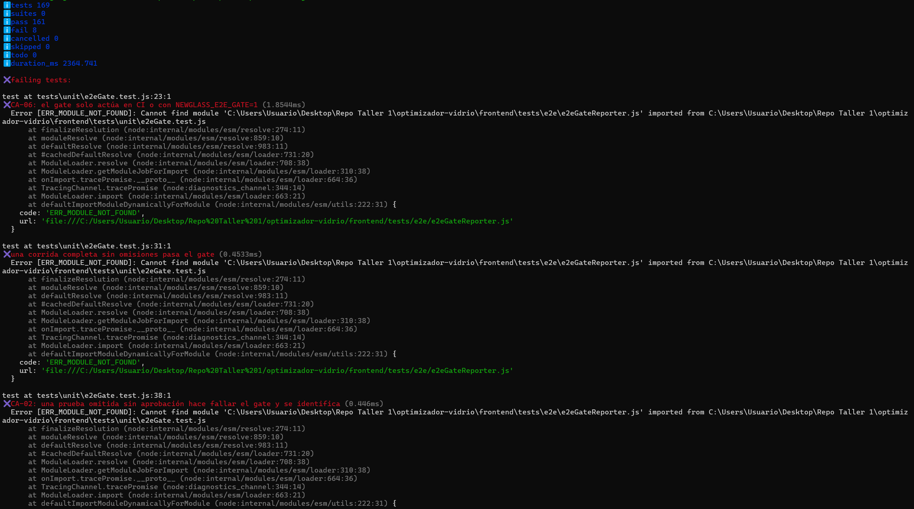
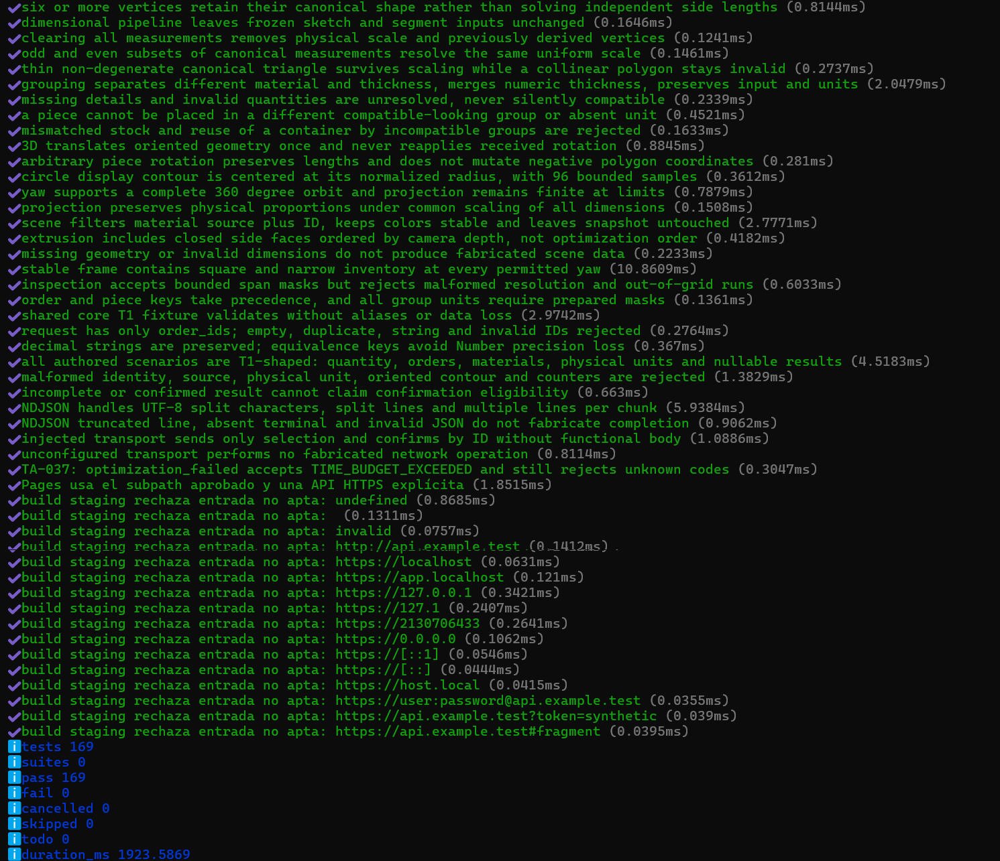

# Evidencia TA-040 — Gate E2E efectivo

| Campo | Valor |
|---|---|
| PBI / tarea | TA-040 / T01 — Eliminar skips silenciosos del gate |
| SPEC | [SPEC-TA-040-gate-e2e-efectivo.md](../../../specs/SPEC-TA-040-gate-e2e-efectivo.md) |
| Rama | `enabler/TA-040-gate-e2e`, desde `integration/sprint-01` en `4bcf54d` |
| Responsable | Fabricio Aguilar |
| Fecha | 27–28/10/2026 (America/Lima) |

## Commits

| Commit | Contenido |
|---|---|
| `2c23bac` | `docs(TA-040)`: SPEC con el diagnóstico, las alternativas y las reglas |
| `5c62d6d` | `test(TA-040)`: pruebas del gate (en rojo) |
| `ci(TA-040)` | Gate, specs críticos, configuración de Playwright y HU-015 sin `test.skip` |
| `docs(TA-040)` | SPEC en Implemented y esta evidencia |

## 1. El problema: un verde que no probaba HU-015

El último CI de integración antes de esta tarea registró 100 E2E aprobados y
**6 omitidos**: las 3 pruebas de `hu015-rasterization.spec.js` en escritorio y
móvil. Cada una tenía `test.skip(!hasHu015Credentials, …)` y el workflow nunca
definía `HU015_E2E_USERNAME/PASSWORD`. Playwright no falla por pruebas omitidas,
así que el job quedaba en verde.

Demostración sobre el código anterior, con PostgreSQL efímero y el servidor E2E real
(`hu015-rasterization.spec.js`, proyecto de escritorio):

| Corrida | Resultado |
|---|---|
| Sin credenciales y sin gate (como el CI anterior) | `3 skipped`, **exit 0** |
| Sin credenciales y con el gate (`NEWGLASS_E2E_GATE=1`) | **exit 1**, con este mensaje: |

```text
Gate E2E (TA-040) fallido:
- omitida sin aprobación: [chromium-desktop] hu015-rasterization.spec.js › HU-015: flujo real de pieza cantidad 5, raster, recuperación, resolución y responsive
- omitida sin aprobación: [chromium-desktop] hu015-rasterization.spec.js › HU-015: CIRCUNFERENCIA se compara con la máscara real del backend
- omitida sin aprobación: [chromium-desktop] hu015-rasterization.spec.js › HU-015: POLIGONO_CONVEXO conserva vertices_mm negativos y columnas sobre 53
- spec crítico sin ejecución exitosa: [chromium-desktop] hu015-rasterization.spec.js
- spec crítico sin ejecución exitosa: [chromium-mobile] hu015-rasterization.spec.js
```

Con el Operario sintético de `e2e_server.py` (`O70000001`), las mismas pruebas
dieron **6 passed**: no estaban rotas, solo nunca se ejecutaban.

## 2. Pruebas del gate: antes (rojo)

Sobre `5c62d6d`, antes de implementar el gate:

```text
npm run test:unit
# tests 169
# pass 161
# fail 8
```



Fallaban las 8 nuevas, porque el gate no existía y HU-015 todavía tenía sus
`test.skip`. Las 161 existentes pasaban.

## 3. Después (verde)

```text
npm run test:unit        # tests 169, pass 169, fail 0
npm run test:component   # 43 archivos, 483 pruebas aprobadas
npm run lint             # sin errores
npm run build            # correcto
```



### E2E completo con el gate activo (`CI=true`)

Linux, Chromium local, PostgreSQL 16 efímero, 2 workers:

```text
106 pruebas (100 anteriores + 6 de HU-015), 0 omitidas
103 passed, 3 failed
Gate E2E (TA-040) fallido:
- spec crítico sin ejecución exitosa: [chromium-mobile] ta036-retazo-personalizado.spec.js
```

Las 3 fallas no provienen de esta tarea:

| Prueba | Con TA-040 | `integration/sprint-01` sin cambios |
|---|---|---|
| `hu012-client-order` (escritorio) | Pasa al repetir | Pasa |
| `ta-dashboard` a 390 px (móvil) | Pasa al repetir | Pasa |
| `ta036-retazo-personalizado` (móvil) | Falla | Falla igual |

Las dos primeras fallaron por tiempo con la máquina cargada. La de `ta036` en
móvil falla solo en este entorno local (versión de Chromium distinta) y también
sin los cambios de TA-040; en el CI de integración pasa. El resultado confirma
que el gate funciona: identificó el spec crítico que no pasó y marcó la corrida
en rojo con un mensaje claro.

## 4. Qué cambió y qué no

- `frontend/tests/e2e/e2eGateReporter.js` (nuevo): reporter que falla ante
  omisiones sin `approved-skip` y specs críticos sin una prueba aprobada por proyecto.
  Solo actúa con `CI=true` o `NEWGLASS_E2E_GATE=1`.
- `frontend/tests/e2e/criticalSpecs.js` (nuevo): los 10 specs críticos (P-01).
- `frontend/playwright.config.js`: agrega el reporter; `list` y `html` se conservan.
- `frontend/tests/e2e/hu015-rasterization.spec.js`: usa el Operario sintético; se
  eliminan las variables `HU015_E2E_*` y los 3 `test.skip`. Las aserciones no cambian.
- Sin cambios en `src/`, el backend, la base de datos, las migraciones ni el workflow.

## 5. Pendiente para Verified

- CI del PR en verde: job `e2e` con 106 pruebas, 0 omitidas y el mensaje
  `Gate E2E (TA-040): … sin omisiones no aprobadas` en el log (CA-07).
- Revisión de un integrante distinto del autor.
- Aviso a Luis (HU-016 T03), que depende de este gate (P-03).
