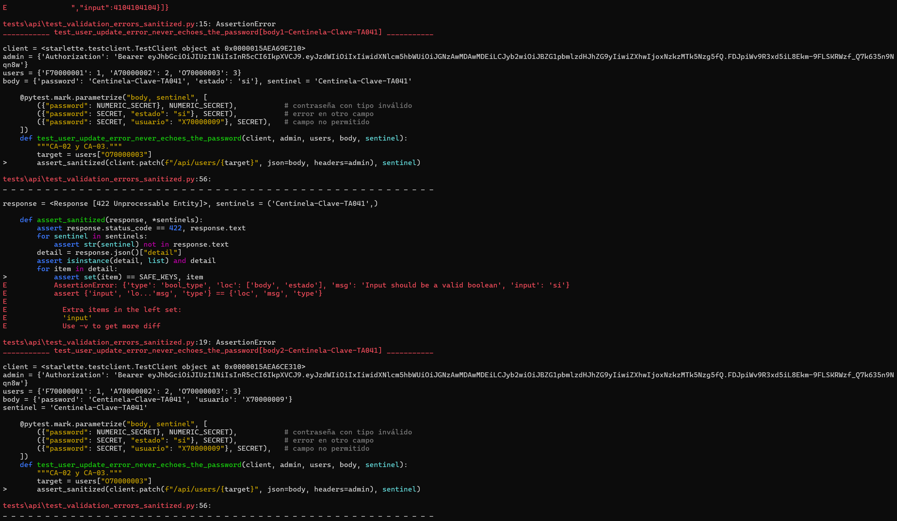
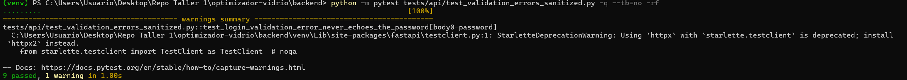

# Evidencia TA-041 — Sanitización de errores de autenticación

| Campo | Valor |
|---|---|
| PBI / tarea | TA-041 / T01 — Evitar eco de contraseña |
| SPEC | [SPEC-TA-041-sanitizacion-errores-autenticacion.md](../../../specs/SPEC-TA-041-sanitizacion-errores-autenticacion.md) |
| Rama | `fix/TA-041-sin-eco-de-contrasena`, desde `integration/sprint-01` en `b4a2ce6` |
| Responsable | Fabricio Aguilar |
| Fecha | 28/10/2026 (America/Lima) |

## Commits

| Commit | Contenido |
|---|---|
| `docs(TA-041)` | SPEC con la reproducción, las alternativas y las reglas |
| `test(TA-041)` | Pruebas de regresión con contraseñas centinela (en rojo) |
| `fix(TA-041)` | Manejador global de errores de validación |
| `docs(TA-041)` | SPEC en Implemented y esta evidencia |

## 1. El problema

Un 422 de validación de FastAPI incluye `input`: el valor recibido o, si falta un
campo, el cuerpo completo. Ejemplos reproducidos con valores de ejemplo:

```text
POST /api/auth/login  {"password": "MiClaveSecreta1"}
422 {"detail":[{"type":"missing","loc":["body","username"],"msg":"Field required",
                "input":{"password":"MiClaveSecreta1"}}]}

PATCH /api/users/{id}  {"password": 1234567890}
422 {"detail":[{"type":"string_type","loc":["body","password"],
                "msg":"Input should be a valid string","input":1234567890}]}
```

## 2. Antes de la corrección (rojo)

Sobre el commit `test(TA-041)`, con el código original:

```text
python -m pytest tests/api/test_validation_errors_sanitized.py -q --tb=no -rf
8 failed, 1 passed
```



| Prueba | Resultado | Qué demuestra |
|---|---|---|
| `test_login_validation_error_never_echoes_the_password` (3 casos) | FAIL | El login devolvía la contraseña: completa si era muy larga, o dentro del cuerpo entero si faltaba el usuario. |
| `test_malformed_login_json_is_sanitized` | FAIL | Un JSON roto respondía con `input` y `ctx`. |
| `test_user_creation_error_in_another_field_does_not_echo_the_password` | FAIL | Un alta sin DNI devolvía el cuerpo entero, contraseña incluida. |
| `test_user_update_error_never_echoes_the_password` (3 casos) | FAIL | La modificación devolvía la contraseña o incluía `input` aunque el error fuera de otro campo. |
| `test_business_messages_and_codes_do_not_change` | PASS | Los mensajes de negocio ya eran seguros; queda como protección. |

## 3. Después de la corrección (verde)

```text
python -m pytest tests/api/test_validation_errors_sanitized.py -q --tb=no -rf
9 passed

python -m pytest -q
1618 passed, 636 skipped    # Windows, sin PostgreSQL de prueba
2254 passed, 0 skipped      # Linux, PostgreSQL efímero (NEWGLASS_REQUIRE_POSTGRES=1)
```



En ambos entornos se ejecutan las mismas 2254 pruebas, sin fallos.

El mismo login de la sección 1 ahora responde:

```text
422 {"detail":[{"loc":["body","username"],"msg":"Field required","type":"missing"}]}
```

## 4. Qué cambió y qué no

- `backend/app/shared/security/validation_errors.py` (nuevo): `sanitized_validation_handler`
  conserva solo `loc`, `msg` y `type`.
- `backend/main.py`: registra el manejador para `RequestValidationError`.
- Sin cambios en el frontend, los mensajes de negocio, los códigos HTTP, las rutas
  con `APIRoute` propia (`orders`, `clients`, `optimization`), la base de datos ni
  las migraciones.
- Efecto en otros módulos (P-02): los 422 de validación de `inventory` y `roles`
  tampoco incluyen ya `input` ni `ctx`. Ningún código ni prueba los usaba.

## 5. Pendiente para Verified

CI del PR en verde (backend con PostgreSQL, frontend y E2E con el gate de TA-040)
y revisión de un integrante distinto del autor.
