# Semana 10 · 28/10–07/11/2026 · solo optimizador-vidrio

## Meléndez Quezada, Wilder Fabricio

Periodo inclusivo según fecha de autor convertida a America/Lima. Las fechas de integración pueden ser diferentes y se conservan en los JSON. Autoría autorizada: Fabricio Melendez Quezada / Fabricio MQ y alias Fabricio Dev, Fabricio y Wilder Fabricio, incluidos los correos MQ; se excluyen fabrilar1 y los demás integrantes. Se inspeccionaron todas las ramas remotas disponibles; integration-02 es la referencia del sprint en el monorepo y main se considera obsoleta allí. Los merges se conservan en el inventario, pero no se atribuye al autor del merge toda la implementación de sus colaboradores.

Capturas nuevas obtenidas el 11/11/2026. Semana 10: código exportado del monorepo en 1277c742de2dc347fab49060b74726c03e8f4341, último primer padre de integration-02 con fecha de autor hasta el 07/11. SP-006 se reprodujo desde 3cc90bcbd, su base original del 02/11. Semana 11: frontend 102abd9 y backend 2afa9d7 de los checkouts seleccionados; cada captura de código incluye su SHA. Las interfaces usan FastAPI, PostgreSQL temporal y fixtures sintéticos. Las capturas de terminal son de xfce4-terminal real y las de código son fragmentos de git show con numeración y coloreado en esa terminal. No son capturas tomadas en los días de los commits ni de producción. Las ilustraciones SP-006 copiadas del repositorio se identifican como gráficos históricos versionados.

### SP-006 — Heurística adicional M6

#### T01 — Investigar y experimentar heurística M6

Se preparó un estudio portable de Beam Search acotada para comparar FF/BF/WF y BS-2/3/4 sobre los casos SMALL, MEDIUM y COMPLEX, con control de geometría, determinismo, tiempo y memoria. Se registraron notebook, fuentes congeladas y evidencia local CPU.

**Comprobación:** 47 pruebas aprobadas al reproducir la revisión original 3cc90bcbd. La ejecución sobre el cierre del 7/11 dio 3 fallos iniciales: uno por falta de contexto Git en la copia exportada y dos por diferencias posteriores de WF. Se conserva el intento y se corrigió usando la base histórica apropiada.

**Alcance:** No se encontró una sesión verificable de Google Colab. RESULTADOS-SP-006.md conserva la decisión personal pendiente; el estudio no acredita por sí solo aceptación formal de M6.

**Commits de soporte:**

- [9524d2ef4f](https://github.com/melendezzz26/optimizador-vidrio/commit/9524d2ef4f6f6fb2eb060bb43dc9781c7c8255b1) — optimizador-vidrio · 9524d2ef4f · 2026-11-02 · Fabricio Dev · feat(experiments): add portable SP-006 beam search Colab study · integrado en origin/integration-02
- [3cc90bcbd4](https://github.com/melendezzz26/optimizador-vidrio/commit/3cc90bcbd48a20e9069438ef005ec6caf7baec9a) — optimizador-vidrio · 3cc90bcbd4 · 2026-11-02 · Fabricio Dev · docs(experiments): record SP-006 validation and local CPU evidence · integrado en origin/integration-02

**Evidencias:**

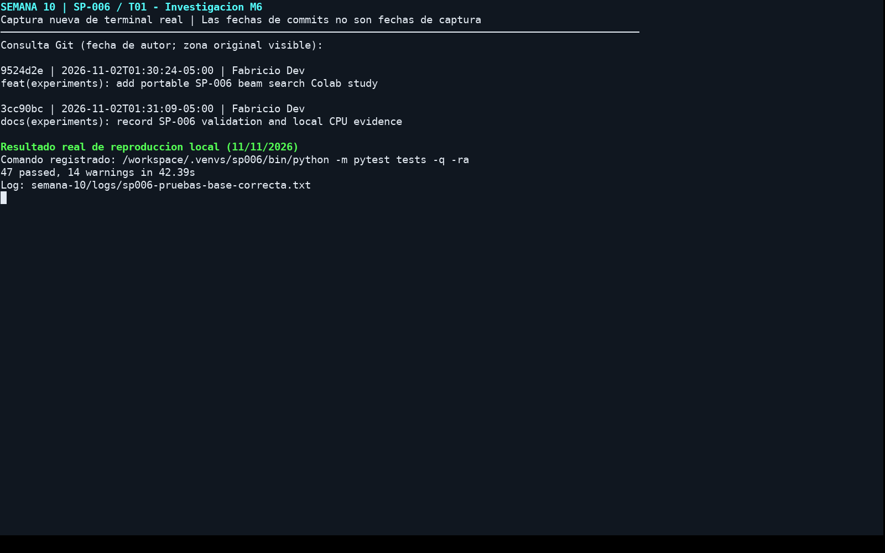

*Captura de terminal real: commits y resultados de la reproducción local.*

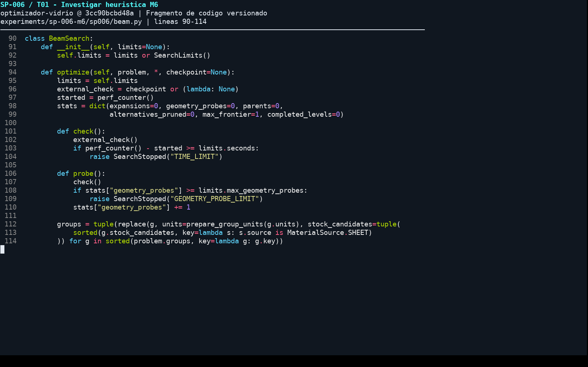

*Límites y algoritmo del experimento M6.*

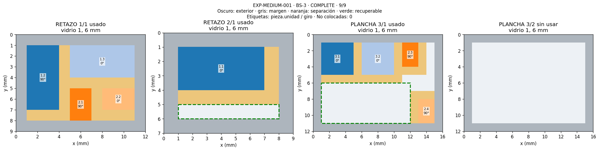

*Gráfico original versionado el 02/11 en 3cc90bcbd; no es una captura nueva de Colab.*

### TA-053 — Heurística M6

#### T01 — Implementar heurística M6

Se implementó M6 como Beam Search acotada en el dominio de optimización, con límites de preparación y búsqueda, resultados tipados y diagnóstico explícito de interrupción.

**Comprobación:** La batería conjunta M6 + adaptadores completó 154 pruebas. El patrón M6-BS se obtuvo mediante la API real en la revisión del cierre de la semana.

**Alcance:** El archivo del cierre semanal contiene mejoras integradas de colaboradores. La atribución personal se sustenta en los commits citados, no en atribuir todo el archivo final a un único autor.

**Commits de soporte:**

- [c96a9719da](https://github.com/melendezzz26/optimizador-vidrio/commit/c96a9719daca2b03d81ed817c585bd0f9db6b64c) — optimizador-vidrio · c96a9719da · 2026-11-02 · Fabricio Dev · feat(optimization): implement bounded M6 beam search · integrado en origin/integration-02
- [5fcc988eea](https://github.com/melendezzz26/optimizador-vidrio/commit/5fcc988eeabed2db784244ffc74068a1be53506b) — optimizador-vidrio · 5fcc988eea · 2026-11-02 · Fabricio Dev · fix(optimization): report M6 preparation time limits · integrado en origin/integration-02

**Evidencias:**

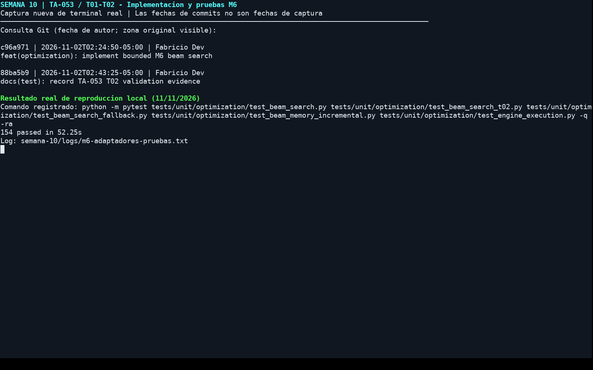

*Captura de terminal real: commits y resultados de la reproducción local.*

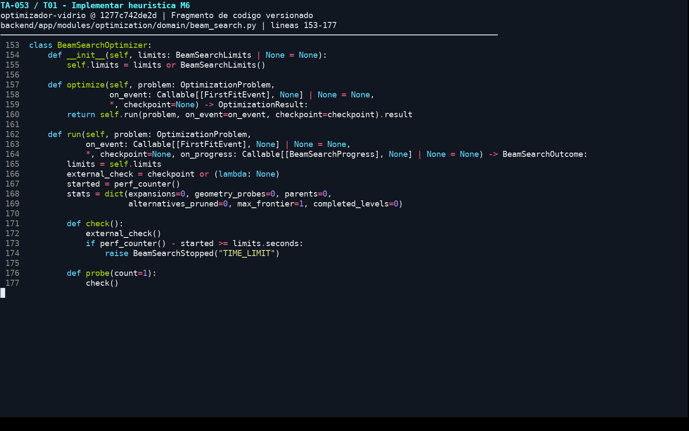

*Entrada del motor M6 y controles de tiempo del estado al 07/11.*

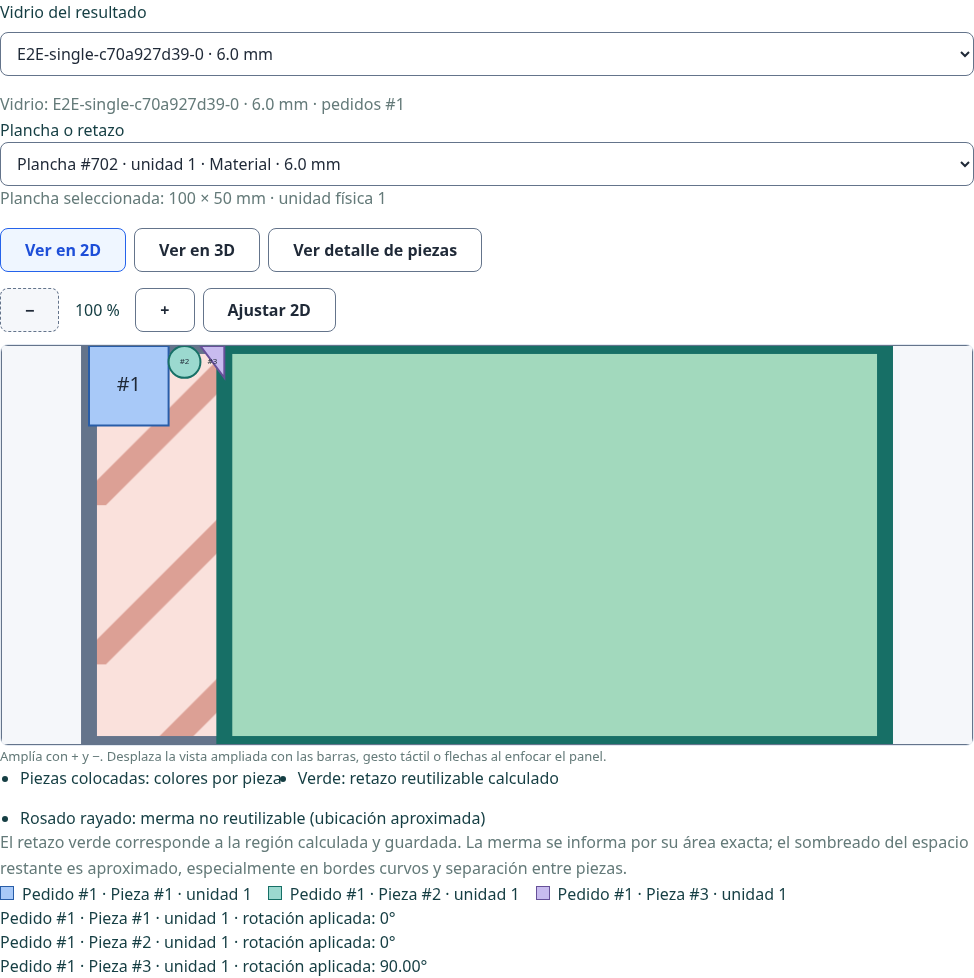

*Resultado real M6-BS en 2D, con datos de prueba locales.*

#### T02 — Crear pruebas de heurística M6

Se documentó y amplió la validación de M6: límites, geometría, repeticiones, inmutabilidad y equivalencia con el experimento SP-006.

**Comprobación:** 154 aprobadas en una ejecución conjunta de test_beam_search.py, test_beam_search_t02.py, test_beam_search_fallback.py, test_beam_memory_incremental.py y test_engine_execution.py. Esta cifra corresponde a toda la selección, no solo a T02.

**Commits de soporte:**

- [88ba5b99e7](https://github.com/melendezzz26/optimizador-vidrio/commit/88ba5b99e76d0d163739ff19f6a578275a20d8e3) — optimizador-vidrio · 88ba5b99e7 · 2026-11-02 · Fabricio Dev · docs(test): record TA-053 T02 validation evidence · integrado en origin/integration-02
- [c96a9719da](https://github.com/melendezzz26/optimizador-vidrio/commit/c96a9719daca2b03d81ed817c585bd0f9db6b64c) — optimizador-vidrio · c96a9719da · 2026-11-02 · Fabricio Dev · feat(optimization): implement bounded M6 beam search · integrado en origin/integration-02

**Evidencias:**

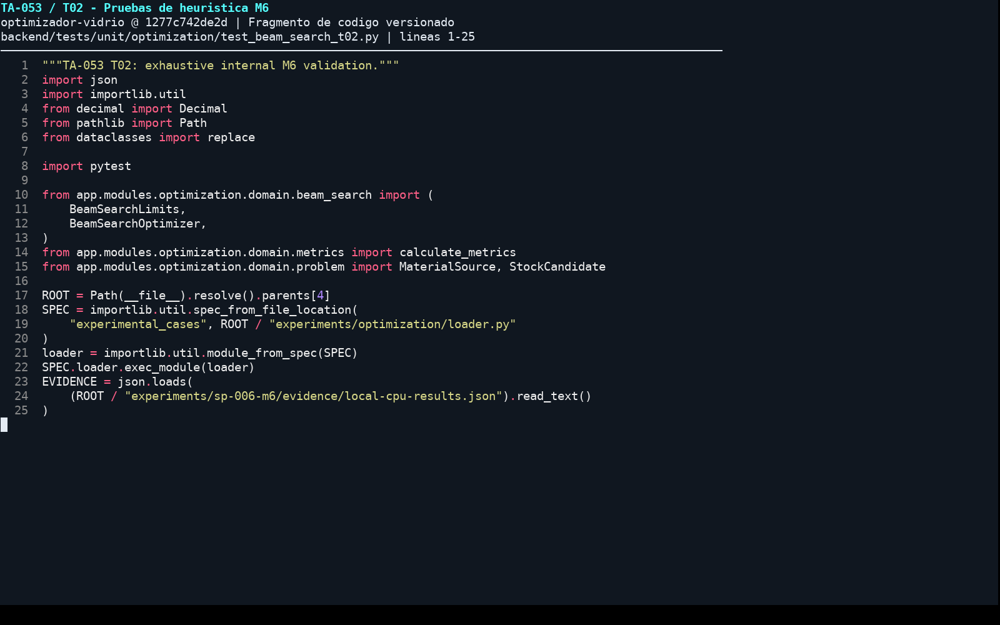

*Pruebas del dominio y fixtures de M6.*

*Captura de terminal real: commits y resultados de la reproducción local.*

### TA-043 — Orquestación extensible multimétodo

#### T01 — Generalizar registro de métodos

Se definió un catálogo explícito para FF, BF, WF, HF, M5 y M6-BS, conservando la compatibilidad del perfil anterior de tres métodos.

**Comprobación:** El escenario B07 comprobó siete pestañas: comparación más seis métodos. La selección de pruebas incluye paridad de motores y adaptadores.

**Commits de soporte:**

- [5dcc3164c0](https://github.com/melendezzz26/optimizador-vidrio/commit/5dcc3164c0ff323eee2119f075cf92233f3823a3) — optimizador-vidrio · 5dcc3164c0 · 2026-11-03 · Fabricio Dev · feat(TA-043): define six-engine comparison contracts · integrado en origin/integration-02
- [11f3d3fd5f](https://github.com/melendezzz26/optimizador-vidrio/commit/11f3d3fd5f3783e10776c80af64d9cac47aec948) — optimizador-vidrio · 11f3d3fd5f · 2026-11-03 · Fabricio Dev · feat(TA-043): adapt six engines with typed diagnostics · integrado en origin/integration-02

**Evidencias:**

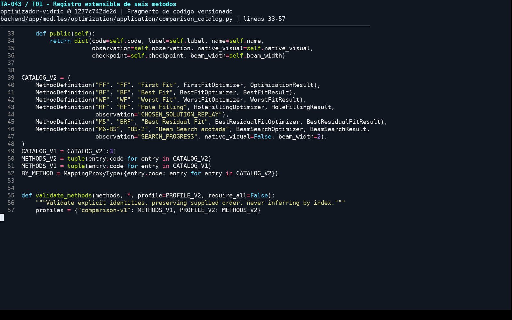

*Catálogo CATALOG_V2 y lista de métodos permitidos.*

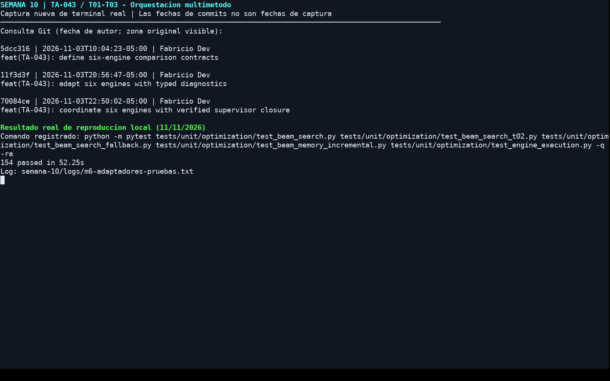

*Captura de terminal real: commits y resultados de la reproducción local.*

#### T02 — Ejecutar seis métodos sobre copias equivalentes

Se incorporaron adaptadores, snapshots versionados y coordinación supervisada para ejecutar cada motor con el mismo pedido, configuración e inventario inicial, con resultados y diagnósticos independientes.

**Comprobación:** B07 pasó con PostgreSQL temporal y API real. Los seis motores completaron el caso controlado sin consumir stock durante la comparación.

**Alcance:** La ejecución de seis motores es secuencial supervisada en v2; no se presenta como seis procesos simultáneos.

**Commits de soporte:**

- [11f3d3fd5f](https://github.com/melendezzz26/optimizador-vidrio/commit/11f3d3fd5f3783e10776c80af64d9cac47aec948) — optimizador-vidrio · 11f3d3fd5f · 2026-11-03 · Fabricio Dev · feat(TA-043): adapt six engines with typed diagnostics · integrado en origin/integration-02
- [8c19b0e297](https://github.com/melendezzz26/optimizador-vidrio/commit/8c19b0e29706f468a33c99073276750ab9f0ade9) — optimizador-vidrio · 8c19b0e297 · 2026-11-03 · Fabricio Dev · feat(TA-043): enforce bounded sequential engine execution · integrado en origin/integration-02
- [70084ceac3](https://github.com/melendezzz26/optimizador-vidrio/commit/70084ceac358d5e62107b52f2c973f42480c46af) — optimizador-vidrio · 70084ceac3 · 2026-11-03 · Fabricio Dev · feat(TA-043): coordinate six engines with verified supervisor closure · integrado en origin/integration-02

**Evidencias:**

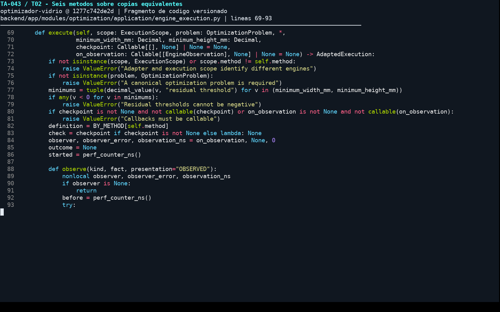

*Adaptador productivo y ámbito de cada ejecución.*

*Captura de terminal real: commits y resultados de la reproducción local.*

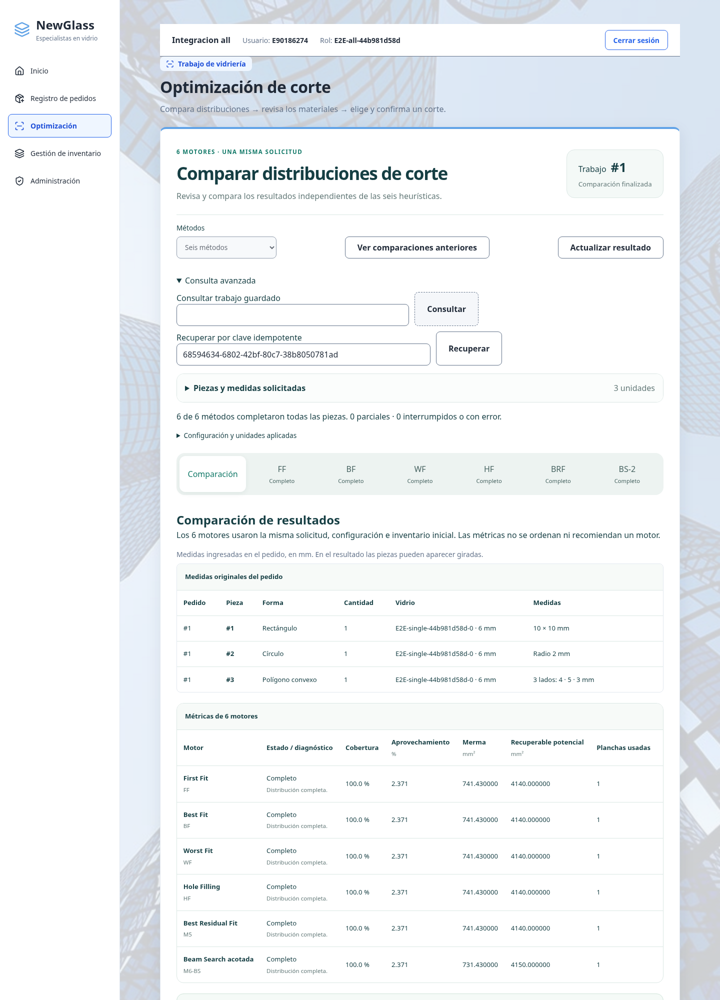

*Comparación real: seis motores sobre una misma solicitud; captura ampliada para leer toda la tabla.*

#### T03 — Ejecutar regresión cruzada de seis métodos

Se verificó paridad entre motores directos y adaptados, preservación de entradas y compatibilidad de contratos, recuperación y confirmación.

**Comprobación:** 154 pruebas aprobadas en la selección conjunta, que incluye test_engine_execution.py. B07 también verificó recuperación visual y compatibilidad v1.

**Commits de soporte:**

- [095ff79f44](https://github.com/melendezzz26/optimizador-vidrio/commit/095ff79f44b51426362757764ccd3bf827410e5c) — optimizador-vidrio · 095ff79f44 · 2026-11-03 · Fabricio Dev · test(TA-043): verify adapter parity and durable diagnostics · integrado en origin/integration-02
- [42e98bde09](https://github.com/melendezzz26/optimizador-vidrio/commit/42e98bde09a744feb7f06b9de1d5847c545ee796) — optimizador-vidrio · 42e98bde09 · 2026-11-03 · Fabricio Dev · test(TA-043): verify multimethod coordination and safe lifecycle · integrado en origin/integration-02
- [bfce808268](https://github.com/melendezzz26/optimizador-vidrio/commit/bfce808268630ae25d697227a98614f97127da87) — optimizador-vidrio · bfce808268 · 2026-11-04 · Fabricio Dev · test(TA-043): cover six-engine comparison workspace · integrado en origin/integration-02

**Evidencias:**

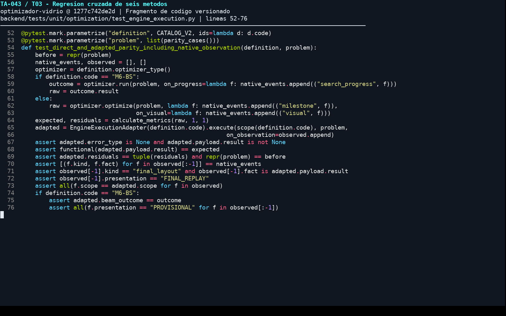

*Prueba parametrizada de paridad directa/adaptada para los seis métodos.*

*Captura de terminal real: commits y resultados de la reproducción local.*

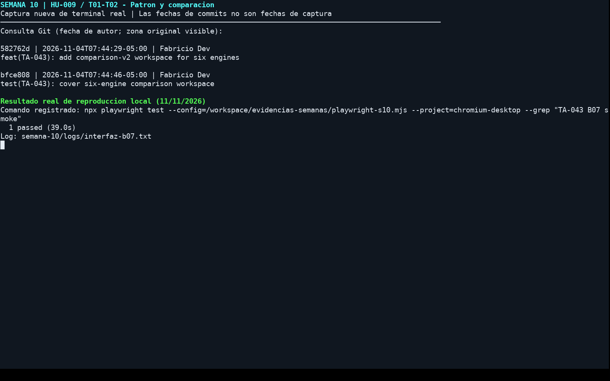

*Captura de terminal real: commits y resultados de la reproducción local.*

### HU-009 — Visualizar patrón

#### T01 — Visualizar resultados por pestañas multimétodo

Se incorporó una vista por motor con patrones 2D/3D y recuperación de resultados persistidos, manteniendo identificadas las ejecuciones.

**Comprobación:** B07 aprobado sobre el estado 1277c742de2d de integration-02 al 07/11; se conservaron capturas de los seis motores.

**Alcance:** La relación con HU-009 usa la estructura solicitada. Los commits de la ampliación a seis motores están rotulados TA-043; no se inventó un commit HU-009 con ese título.

**Commits de soporte:**

- [582762da3b](https://github.com/melendezzz26/optimizador-vidrio/commit/582762da3b010ca1e20adecad8cc9e336ebb90a5) — optimizador-vidrio · 582762da3b · 2026-11-04 · Fabricio Dev · feat(TA-043): add comparison-v2 workspace for six engines · integrado en origin/integration-02
- [bfce808268](https://github.com/melendezzz26/optimizador-vidrio/commit/bfce808268630ae25d697227a98614f97127da87) — optimizador-vidrio · bfce808268 · 2026-11-04 · Fabricio Dev · test(TA-043): cover six-engine comparison workspace · integrado en origin/integration-02

**Evidencias:**

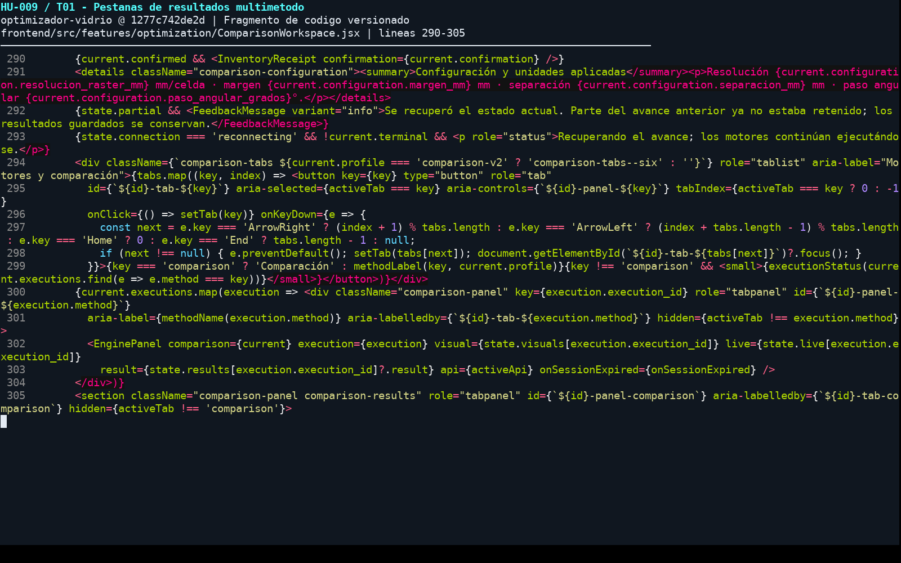

*Pestañas accesibles de motores y comparación.*

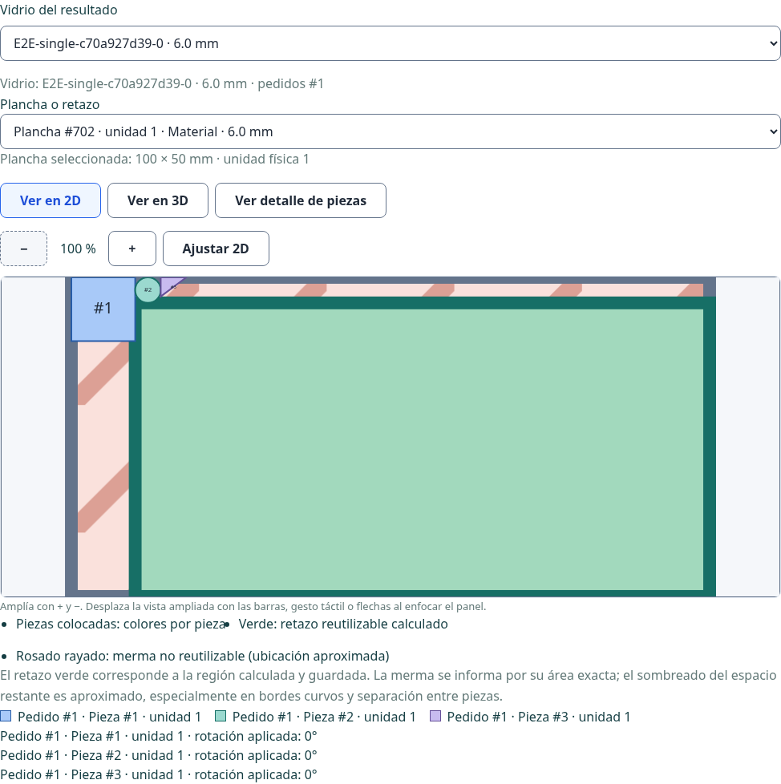

*Distribución FF con pestañas y resultado independiente.*

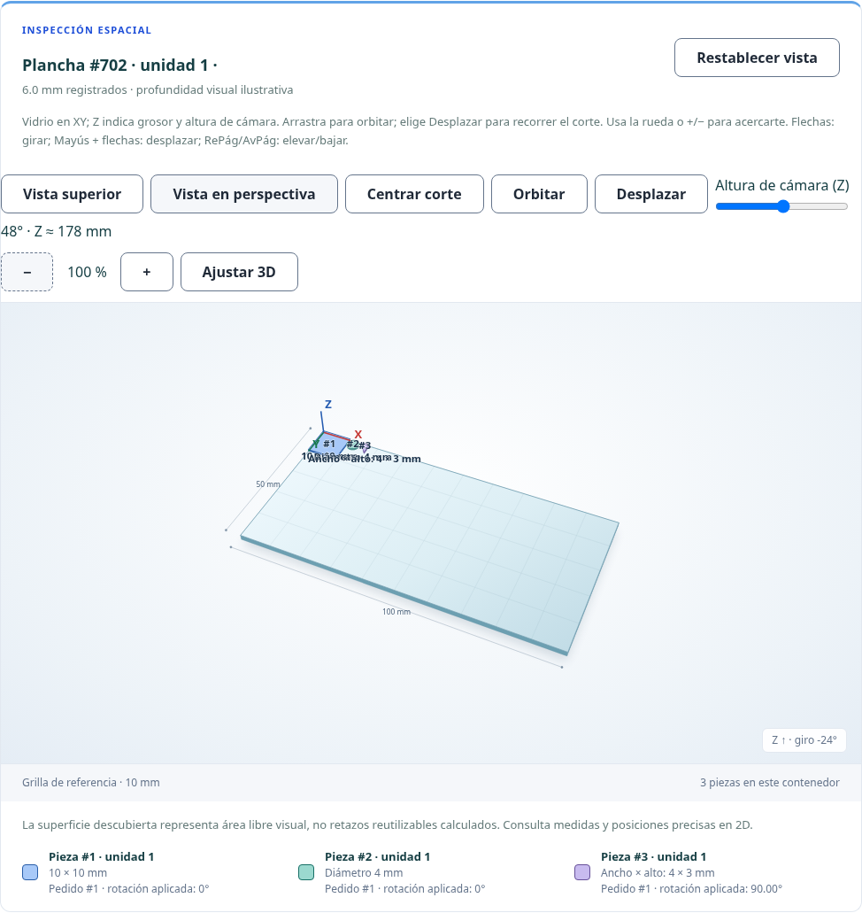

*Vista 3D real de la distribución M6-BS.*

#### T02 — Mostrar comparación visible de seis métodos

Se añadió una comparación con estado, cobertura, aprovechamiento, merma, área recuperable y fuentes utilizadas, manteniendo la selección manual.

**Comprobación:** B07 aprobado, radios de selección presentes y confirmación bloqueada mientras no se elige una distribución.

**Commits de soporte:**

- [582762da3b](https://github.com/melendezzz26/optimizador-vidrio/commit/582762da3b010ca1e20adecad8cc9e336ebb90a5) — optimizador-vidrio · 582762da3b · 2026-11-04 · Fabricio Dev · feat(TA-043): add comparison-v2 workspace for six engines · integrado en origin/integration-02
- [bfce808268](https://github.com/melendezzz26/optimizador-vidrio/commit/bfce808268630ae25d697227a98614f97127da87) — optimizador-vidrio · bfce808268 · 2026-11-04 · Fabricio Dev · test(TA-043): cover six-engine comparison workspace · integrado en origin/integration-02
- [d2d21b2a61](https://github.com/melendezzz26/optimizador-vidrio/commit/d2d21b2a61f994c259ea9ad7218f1df7e3d4e823) — optimizador-vidrio · d2d21b2a61 · 2026-11-04 · Fabricio Dev · feat(TA-043): add v2 selection and confirmation · integrado en origin/integration-02

**Evidencias:**

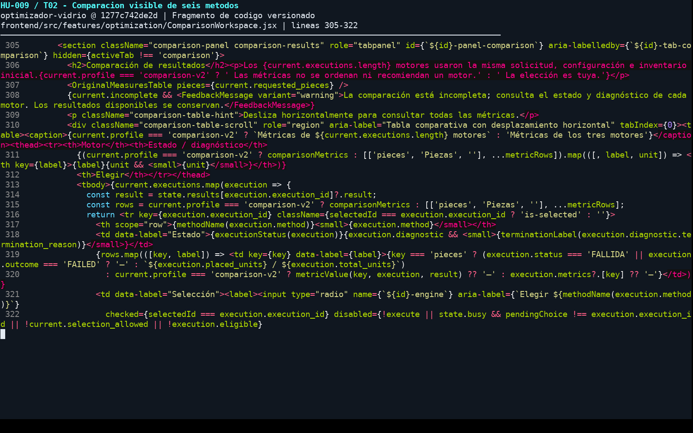

*Construcción de la tabla comparativa y métricas.*

*Tabla comparativa visible de FF/BF/WF/HF/M5/M6-BS.*

*Captura de terminal real: commits y resultados de la reproducción local.*
