# Semana 11 · 08/11–11/11/2026 · monorepo y repositorios independientes

## Meléndez Quezada, Wilder Fabricio

Periodo inclusivo según fecha de autor convertida a America/Lima. Las fechas de integración pueden ser diferentes y se conservan en los JSON. Autoría autorizada: Fabricio Melendez Quezada / Fabricio MQ y alias Fabricio Dev, Fabricio y Wilder Fabricio, incluidos los correos MQ; se excluyen fabrilar1 y los demás integrantes. Se inspeccionaron todas las ramas remotas disponibles; integration-02 es la referencia del sprint en el monorepo y main se considera obsoleta allí. Los merges se conservan en el inventario, pero no se atribuye al autor del merge toda la implementación de sus colaboradores.

Capturas nuevas obtenidas el 11/11/2026. Semana 10: código exportado del monorepo en 1277c742de2dc347fab49060b74726c03e8f4341, último primer padre de integration-02 con fecha de autor hasta el 07/11. SP-006 se reprodujo desde 3cc90bcbd, su base original del 02/11. Semana 11: frontend 102abd9 y backend 2afa9d7 de los checkouts seleccionados; cada captura de código incluye su SHA. Las interfaces usan FastAPI, PostgreSQL temporal y fixtures sintéticos. Las capturas de terminal son de xfce4-terminal real y las de código son fragmentos de git show con numeración y coloreado en esa terminal. No son capturas tomadas en los días de los commits ni de producción. Las ilustraciones SP-006 copiadas del repositorio se identifican como gráficos históricos versionados.

Los rótulos T01/T02/T03 de esta semana son una agrupación propuesta de los commits, con la jerarquía solicitada; no se verificaron IDs de tareas en Notion.

### TA-053 — Heurística M6 · continuidad

#### T01 — Preservar M6 nativo y ampliar admisión académica

Se ajustó la admisión de lotes académicos de hasta 800 unidades conservando M6 como método nativo y límites explícitos.

**Comprobación:** Se revisaron los commits y pasaron 7 pruebas del perfil de recursos en el backend actual. No se ejecutó en esta revisión una carga nueva de 800 piezas ni un despliegue de 512 MiB.

**Commits de soporte:**

- [2cb11202d3](https://github.com/melendezzz26/optimizador-vidrio/commit/2cb11202d3869b865cf96ce0830421895cec9542) — optimizador-vidrio · 2cb11202d3 · 2026-11-08 · Wilder Fabricio · fix(optimization): keep M6 native and admit academic 800-piece batches · integrado en origin/integration-02
- [13a83164d8](https://github.com/melendezzz26/optimizador-vidrio/commit/13a83164d84e794c24ba8603b4d570dc5fc2b26b) — optimizador-vidrio · 13a83164d8 · 2026-11-08 · Wilder Fabricio · test: verify six native methods within a 512 MiB deployment budget · integrado en origin/integration-02

**Evidencias:**

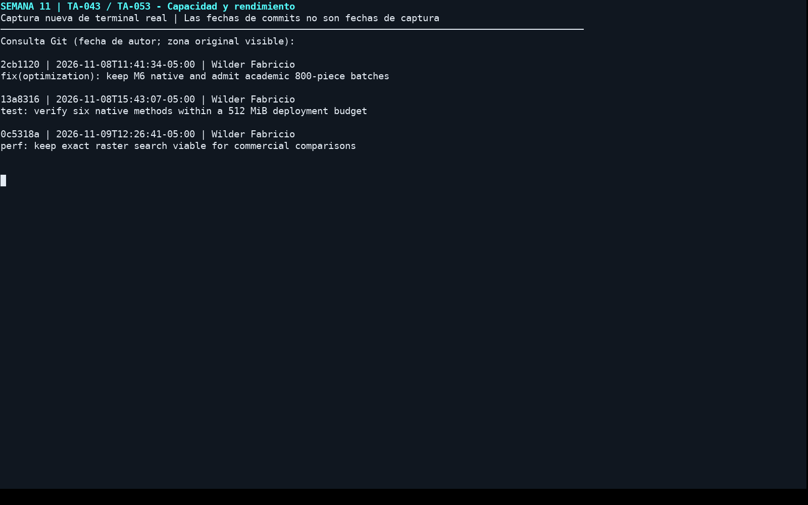

*Captura de terminal real: commits y resultados de la reproducción local.*

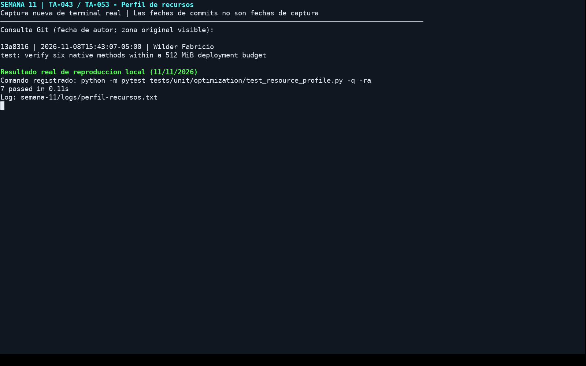

*Captura de terminal real: commits y resultados de la reproducción local.*

### TA-043 — Orquestación extensible multimétodo · continuidad

#### T01 — Controlar perfil de memoria y mejorar rendimiento raster

Se incorporaron comprobaciones del perfil Basic y ajustes de transporte visual, memoria de máscaras y búsqueda raster exacta.

**Comprobación:** 7 pruebas del perfil aprobadas. La medición de 512 MiB se encuentra documentada en el commit histórico; no se presenta como medición nueva de este entorno.

**Commits de soporte:**

- [6423ae0848](https://github.com/melendezzz26/optimizador-vidrio/commit/6423ae0848bde4d773047ffadef587d960cd8b7c) — optimizador-vidrio · 6423ae0848 · 2026-11-08 · Wilder Fabricio · fix: bound deployment memory overrides and avoid full result reads for visualization · integrado en origin/integration-02
- [bebe1ea407](https://github.com/melendezzz26/optimizador-vidrio/commit/bebe1ea40760c69d8db7ba64b1c831d745056006) — optimizador-vidrio · bebe1ea407 · 2026-11-08 · Wilder Fabricio · test: profile full HTTP comparison and reduce visual transport overhead · integrado en origin/integration-02
- [13a83164d8](https://github.com/melendezzz26/optimizador-vidrio/commit/13a83164d84e794c24ba8603b4d570dc5fc2b26b) — optimizador-vidrio · 13a83164d8 · 2026-11-08 · Wilder Fabricio · test: verify six native methods within a 512 MiB deployment budget · integrado en origin/integration-02
- [0c5318ad39](https://github.com/melendezzz26/optimizador-vidrio/commit/0c5318ad395bc65a638072842a6dbacf786bd26f) — optimizador-vidrio · 0c5318ad39 · 2026-11-09 · Wilder Fabricio · perf: keep exact raster search viable for commercial comparisons · integrado en origin/integration-02

**Evidencias:**

*Captura de terminal real: commits y resultados de la reproducción local.*

*Captura de terminal real: commits y resultados de la reproducción local.*

#### T02 — Reintentar cierre verificado antes de admitir otro pedido

Se reforzó el cierre de comparaciones y el control de máscaras de rotación para pedidos variados.

**Comprobación:** B07 y el escenario de cancelación real pasaron en la reproducción actual. Esto no sustituye una medición histórica de carga.

**Commits de soporte:**

- [08d8cbd9f6](https://github.com/melendezzz26/optimizador-vidrio/commit/08d8cbd9f60c07509b43722899e9f8d914b52eea) — optimizador-vidrio · 08d8cbd9f6 · 2026-11-09 · Wilder Fabricio · fix: retry verified comparison closure before admitting another order · integrado en origin/integration-02
- [db571141b4](https://github.com/melendezzz26/optimizador-vidrio/commit/db571141b4995345f2838d172156be5eed96e2c4) — optimizador-vidrio · db571141b4 · 2026-11-09 · Wilder Fabricio · fix: bound live rotation masks for varied cutting orders · integrado en origin/integration-02

**Evidencias:**

*Captura de terminal real: commits y resultados de la reproducción local.*

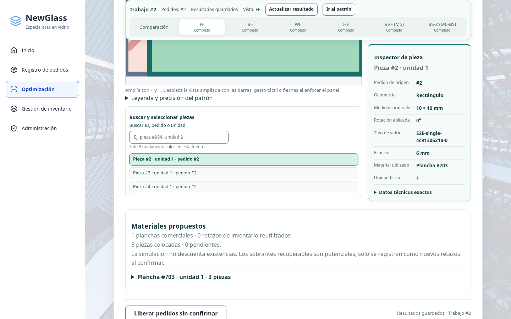

*Trabajo persistido recuperado en la interfaz actual.*

### EN-REPO-001 — Separación de repositorios

#### T01 — Definir separación y preservar trazabilidad

Se documentaron ADR, especificación y plan para separar frontend y backend, conservando el monorepo para documentación y trazabilidad.

**Comprobación:** Se verificaron las ramas remotas de documentación y extracción, además de los repositorios independientes. Su inclusión no equivale a declarar fusionadas las ramas documentales.

**Commits de soporte:**

- [3bacf6dfb4](https://github.com/melendezzz26/optimizador-vidrio/commit/3bacf6dfb4c3a1c133fc9dcb819707d580079487) — optimizador-vidrio · 3bacf6dfb4 · 2026-11-10 · Wilder Fabricio · docs(EN-REPO-001): definir especificación de separación · no integrado en origin/integration-02; ver ramas en commits.csv
- [a9643d4c47](https://github.com/melendezzz26/optimizador-vidrio/commit/a9643d4c47807fcf5dcca0557df286a2bc9afffa) — optimizador-vidrio · a9643d4c47 · 2026-11-10 · Wilder Fabricio · docs(EN-REPO-001): aceptar ADR-003 por aprobación del responsable · no integrado en origin/integration-02; ver ramas en commits.csv
- [a4cad18d15](https://github.com/melendezzz26/optimizador-vidrio/commit/a4cad18d152d3254d88215b929342f9e721a0fc5) — optimizador-vidrio · a4cad18d15 · 2026-11-10 · Wilder Fabricio · docs(EN-REPO-001): documentar extracción segura, pruebas, trazabilidad y publicación · no integrado en origin/integration-02; ver ramas en commits.csv

**Evidencias:**

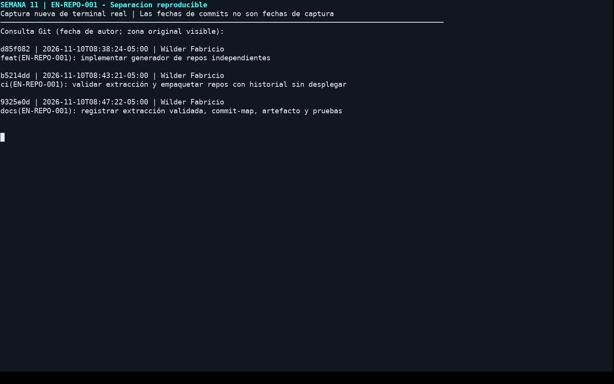

*Captura de terminal real: commits y resultados de la reproducción local.*

#### T02 — Implementar extracción reproducible con historial y CI

Se creó un generador de repositorios independientes y un flujo de empaquetado/validación, con correspondencia entre commits originales y filtrados.

**Comprobación:** El script y el registro de extracción fueron revisados por commit. No se volvió a ejecutar la extracción ni se publicaron repositorios en esta revisión.

**Commits de soporte:**

- [d85f0827a2](https://github.com/melendezzz26/optimizador-vidrio/commit/d85f0827a2a74e053b03406f211d3caaf94d1134) — optimizador-vidrio · d85f0827a2 · 2026-11-10 · Wilder Fabricio · feat(EN-REPO-001): implementar generador de repos independientes · no integrado en origin/integration-02; ver ramas en commits.csv
- [b5214dd2bf](https://github.com/melendezzz26/optimizador-vidrio/commit/b5214dd2bf4c92ea551e83f2516c51bd48102234) — optimizador-vidrio · b5214dd2bf · 2026-11-10 · Wilder Fabricio · ci(EN-REPO-001): validar extracción y empaquetar repos con historial sin desplegar · no integrado en origin/integration-02; ver ramas en commits.csv
- [9325e0df6d](https://github.com/melendezzz26/optimizador-vidrio/commit/9325e0df6d4dcea206ad7e8b061deb757b9de26b) — optimizador-vidrio · 9325e0df6d · 2026-11-10 · Wilder Fabricio · docs(EN-REPO-001): registrar extracción validada, commit-map, artefacto y pruebas · no integrado en origin/integration-02; ver ramas en commits.csv

**Evidencias:**

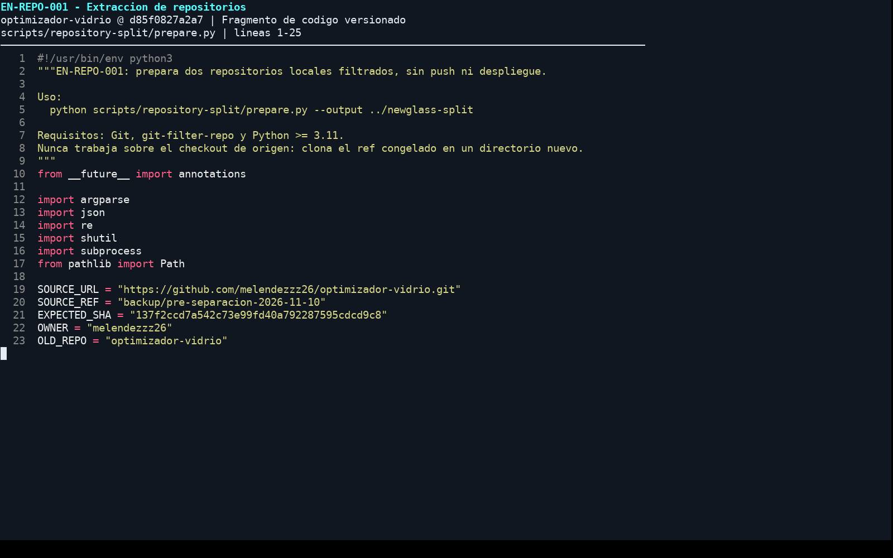

*Generador de repositorios desde el monorepo.*

*Captura de terminal real: commits y resultados de la reproducción local.*

#### T03 — Validar desarrollo y E2E entre repositorios separados

Se preparó la ejecución de frontend y backend como checkouts independientes y se verificó el contrato actual desde el navegador.

**Comprobación:** 217 unitarias y 648 pruebas de componentes del frontend aprobadas; lint y build correctos. Dos escenarios E2E de B07/cancelación aprobados contra FastAPI y PostgreSQL temporales.

**Alcance:** Para reproducir los tests existentes se añadió un alias local /workspace/backend hacia newglass-backend; no se cambió código para adaptar las rutas.

**Commits de soporte:**

- [1dc56ab28d](https://github.com/melendezzz26/newglass-frontend/commit/1dc56ab28df7b3709e84ccfdbb4e5719faf4ad42) — newglass-frontend · 1dc56ab28d · 2026-11-11 · Wilder Fabricio · test(EN-UX-004): fijar CI al backend ya integrado en main · integrado en origin/main
- [8c32853939](https://github.com/melendezzz26/newglass-backend/commit/8c328539392492fdb2995bcc7788306f40c4cf66) — newglass-backend · 8c32853939 · 2026-11-11 · Wilder Fabricio · test(EN-UX-004): habilitar worker real controlado solo en servidor E2E loopback · integrado en origin/main

**Evidencias:**

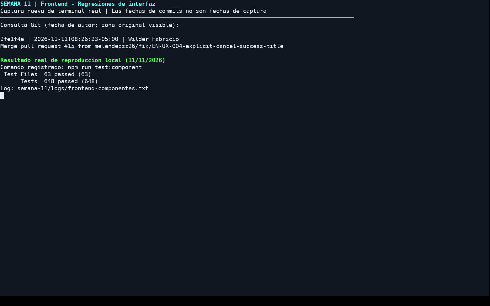

*Captura de terminal real: commits y resultados de la reproducción local.*

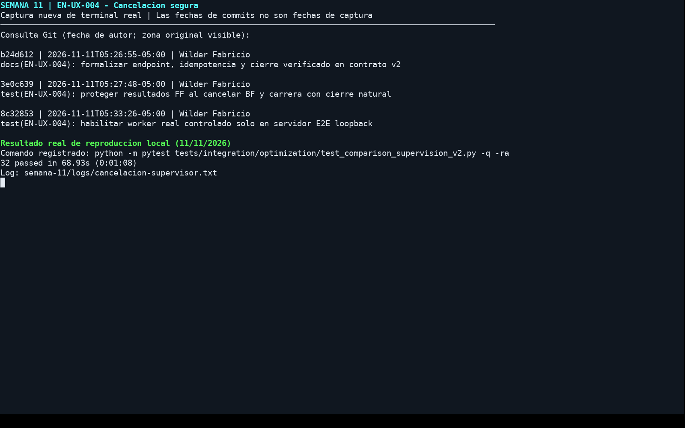

*Captura de terminal real: commits y resultados de la reproducción local.*

### EN-UX-001 — Resultados operativos

#### T01 — Acercar contexto, métricas y comparación al patrón

Se reorganizó la comparación con barra contextual, resumen operativo, áreas legibles y detalle técnico exacto de los seis motores.

**Comprobación:** B07 aprobado; capturas de la interfaz actual con tabla operativa y resultados reales.

**Commits de soporte:**

- [16f47d1f22](https://github.com/melendezzz26/newglass-frontend/commit/16f47d1f22da9908d20842f094bd08422494ed65) — newglass-frontend · 16f47d1f22 · 2026-11-10 · Wilder Fabricio · feat(EN-UX-001): fijar contexto y acercar métricas y patrón al operario · integrado en origin/main
- [6ce46d3bfb](https://github.com/melendezzz26/newglass-frontend/commit/6ce46d3bfb10399aaf9ef2b6c49bc3260665c333) — newglass-frontend · 6ce46d3bfb · 2026-11-10 · Wilder Fabricio · feat(EN-UX-001): comparar seis motores con resumen operativo y detalle exacto · integrado en origin/main
- [e125b262f8](https://github.com/melendezzz26/newglass-frontend/commit/e125b262f859caad6c4ba1b410d7af65edc6bcac) — newglass-frontend · e125b262f8 · 2026-11-10 · Wilder Fabricio · style(EN-UX-001): barra de contexto y resultados compactos para PC · integrado en origin/main

**Evidencias:**

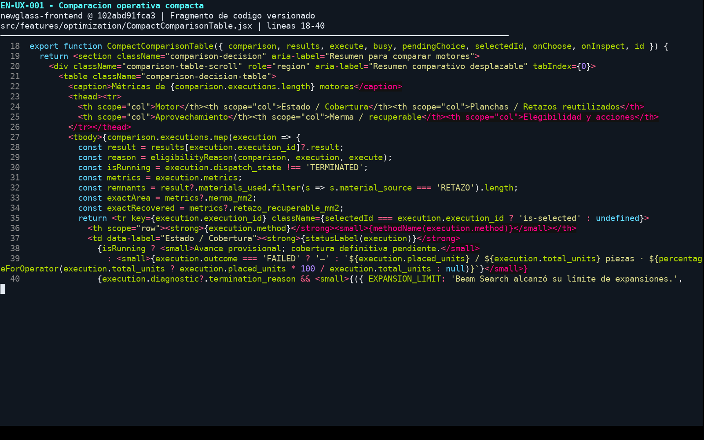

*Tabla comparativa compacta con métricas y acciones.*

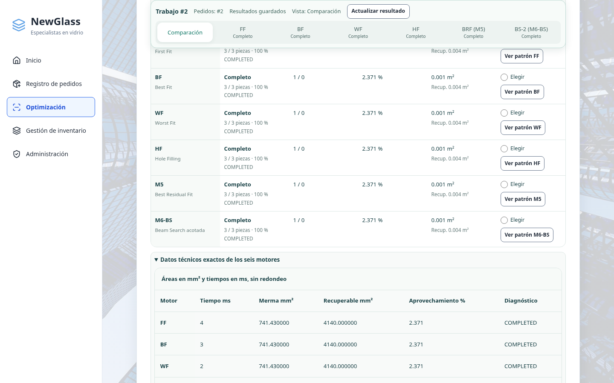

*Comparación operativa y detalle técnico de seis motores.*

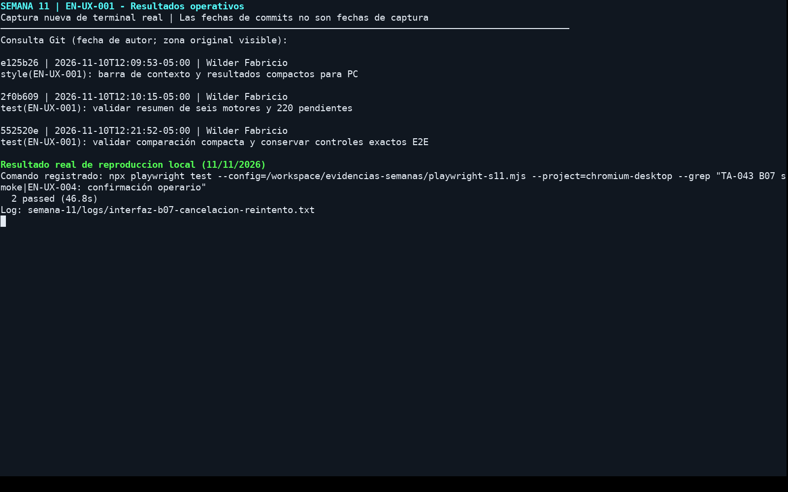

*Captura de terminal real: commits y resultados de la reproducción local.*

#### T02 — Unificar medidas originales y agrupar pendientes

Se centralizó la consulta de medidas originales y se agruparon unidades pendientes por pedido, pieza y motivo, conservando trazabilidad.

**Comprobación:** 648 pruebas de componentes y 217 unitarias aprobadas para el frontend completo. La prueba de 220 pendientes está registrada en los commits; no se afirma que esa cantidad aparezca en las capturas del caso de tres piezas.

**Commits de soporte:**

- [636dddc24a](https://github.com/melendezzz26/newglass-frontend/commit/636dddc24acb1ba00180e513b310d853c75d2bb5) — newglass-frontend · 636dddc24a · 2026-11-10 · Wilder Fabricio · feat(EN-UX-001): agrupar unidades pendientes con trazabilidad exacta · integrado en origin/main
- [2f0b60916b](https://github.com/melendezzz26/newglass-frontend/commit/2f0b60916b31ea7daa41b9757437452c7ba9e64d) — newglass-frontend · 2f0b60916b · 2026-11-10 · Wilder Fabricio · test(EN-UX-001): validar resumen de seis motores y 220 pendientes · integrado en origin/main
- [2ceb10f3aa](https://github.com/melendezzz26/newglass-frontend/commit/2ceb10f3aa5c1b1808865ef3fa96d970f66d8559) — newglass-frontend · 2ceb10f3aa · 2026-11-10 · Wilder Fabricio · test(EN-UX-001): comprobar medidas originales sin repetición en motores · integrado en origin/main

**Evidencias:**

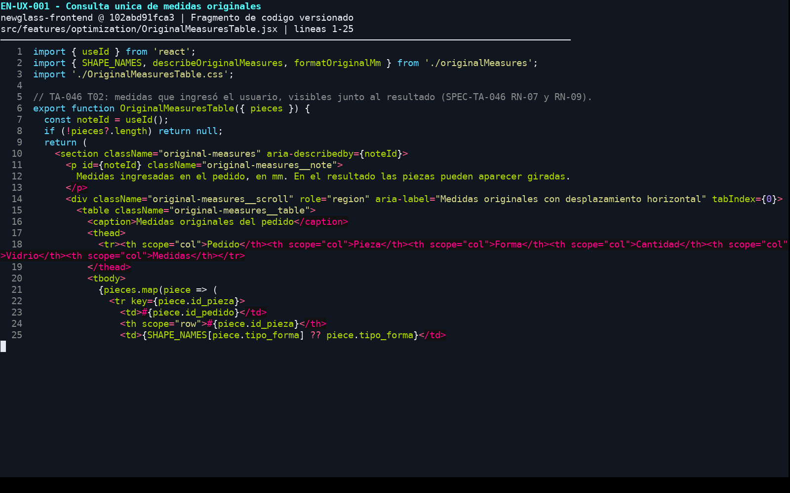

*Tabla única de medidas originales.*

*Captura de terminal real: commits y resultados de la reproducción local.*

*Captura de terminal real: commits y resultados de la reproducción local.*

### EN-UX-002 — Selección e inspector de piezas

#### T01 — Sincronizar selección 2D/3D, lista e identidad

Se modeló la identidad de cada unidad y se sincronizó la selección desde el patrón, la lista y la fuente, sin mover la cámara al seleccionar.

**Comprobación:** B07 verificó interacción real 2D/3D y selección en la interfaz actual.

**Commits de soporte:**

- [63c480cf1e](https://github.com/melendezzz26/newglass-frontend/commit/63c480cf1e1f2cd8c2f0d8d05d2f7c6f7d5659eb) — newglass-frontend · 63c480cf1e · 2026-11-10 · Wilder Fabricio · feat(EN-UX-002): modelar identidad y lectura original de la pieza · integrado en origin/main
- [322791f278](https://github.com/melendezzz26/newglass-frontend/commit/322791f27888d6a72997352afa9106dbd58e63e6) — newglass-frontend · 322791f278 · 2026-11-10 · Wilder Fabricio · feat(EN-UX-002): compartir selección 2D, fuente, listado e inspector · integrado en origin/main
- [a5311c16ab](https://github.com/melendezzz26/newglass-frontend/commit/a5311c16ab24ee08790980925db6210d8ee46293) — newglass-frontend · a5311c16ab · 2026-11-10 · Wilder Fabricio · feat(EN-UX-002): selección directa en 3D SVG sin mover cámara ni saturar etiquetas · integrado en origin/main

**Evidencias:**

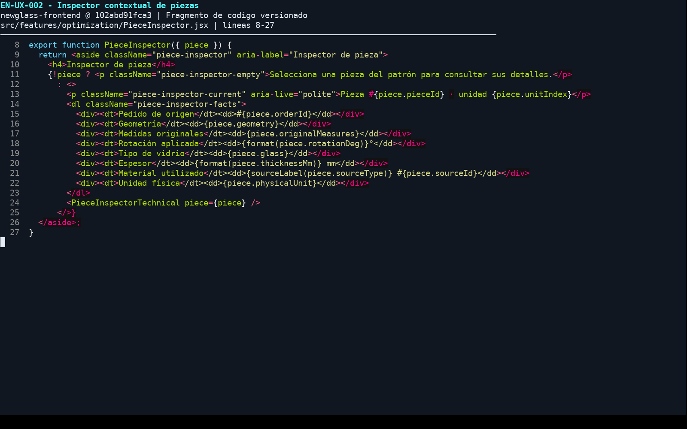

*Lectura de medidas, rotación y origen de una pieza seleccionada.*

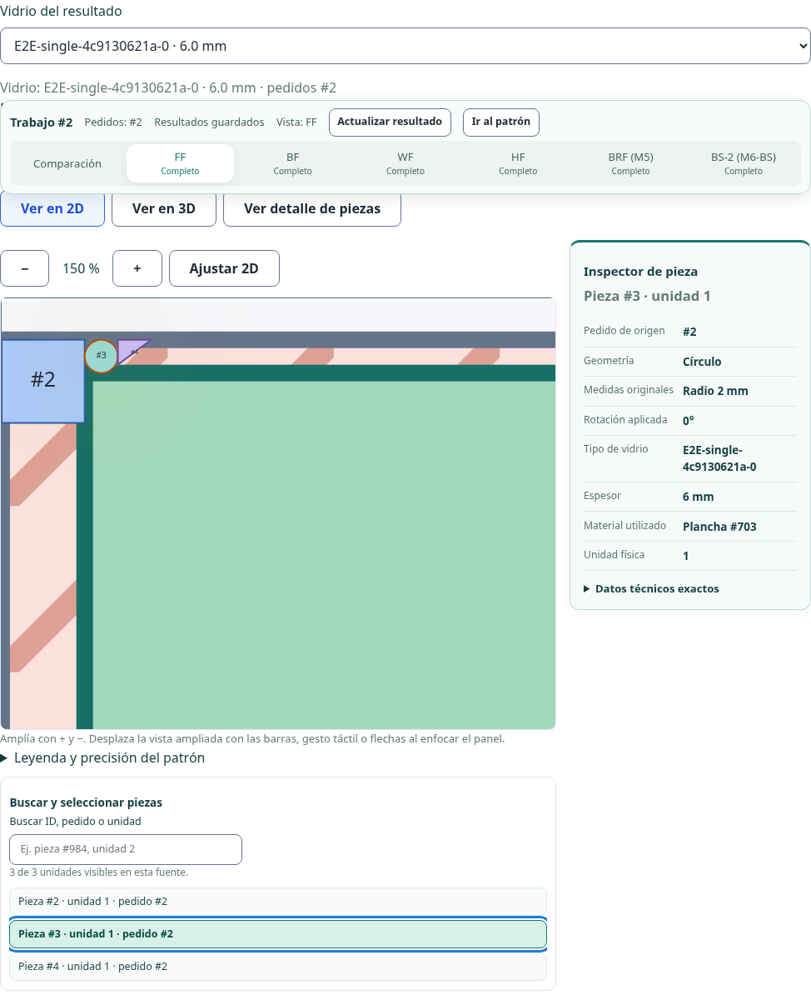

*Selección en 2D sincronizada con inspector.*

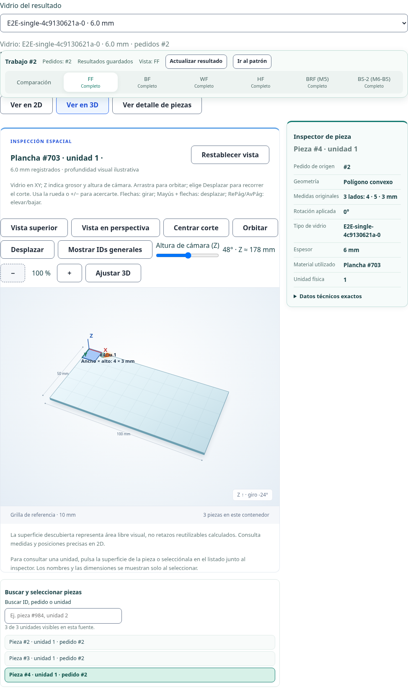

*Selección en 3D con información de la misma pieza.*

#### T02 — Mostrar inspector contextual y verificar escritorio

Se incorporó un inspector lateral con pedido, geometría, medidas, rotación, vidrio, espesor y unidad física.

**Comprobación:** B07 aprobó las comprobaciones de geometría de la interfaz en 1366×768 y 1920×1080.

**Commits de soporte:**

- [751b169ad6](https://github.com/melendezzz26/newglass-frontend/commit/751b169ad624d89620b80f01737909d4892bbbd5) — newglass-frontend · 751b169ad6 · 2026-11-10 · Wilder Fabricio · feat(EN-UX-002): añadir inspector contextual sin datos simulados · integrado en origin/main
- [6778e0fda9](https://github.com/melendezzz26/newglass-frontend/commit/6778e0fda9759daecac3dbabe629382b4daf3134) — newglass-frontend · 6778e0fda9 · 2026-11-10 · Wilder Fabricio · test(EN-UX-002): verificar inspector sin solapamiento en 1366×768 y 1920×1080 · integrado en origin/main
- [14c14eb310](https://github.com/melendezzz26/newglass-frontend/commit/14c14eb310391f16689d714c3f67af40738c5625) — newglass-frontend · 14c14eb310 · 2026-11-10 · Wilder Fabricio · test(EN-UX-002): verificar selección 2D/3D, fuente, teclado e histórico en E2E aislado · integrado en origin/main

**Evidencias:**

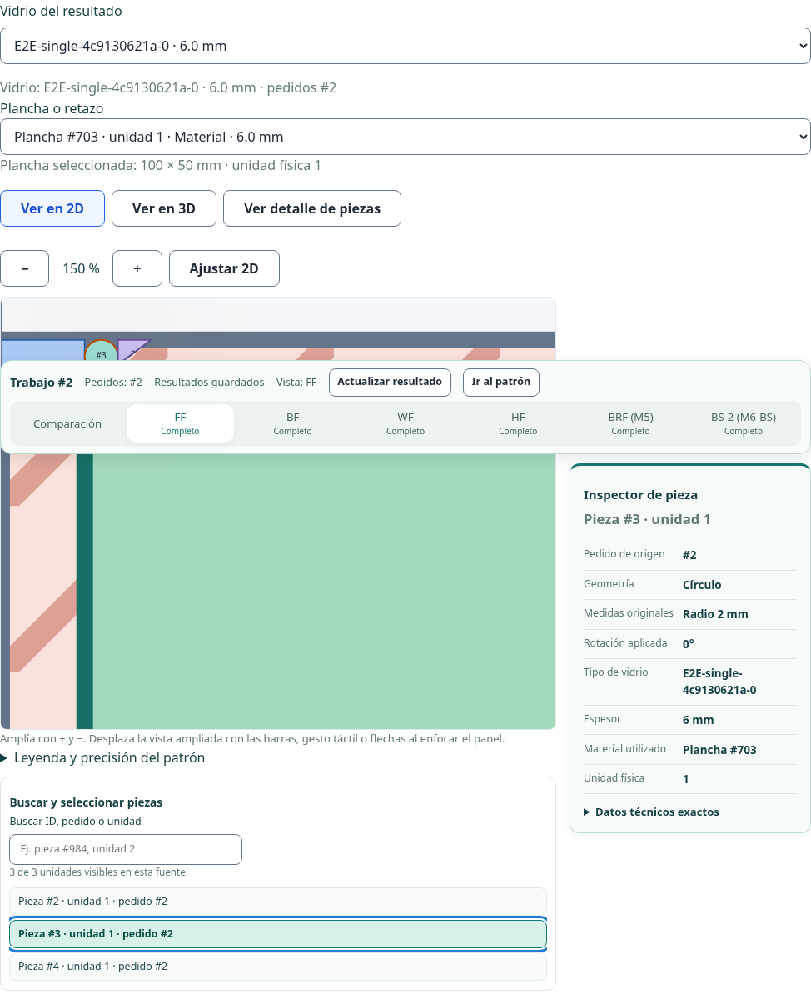

*Inspector sin solapamientos a 1366×768.*

*Inspector sin solapamientos a 1920×1080.*

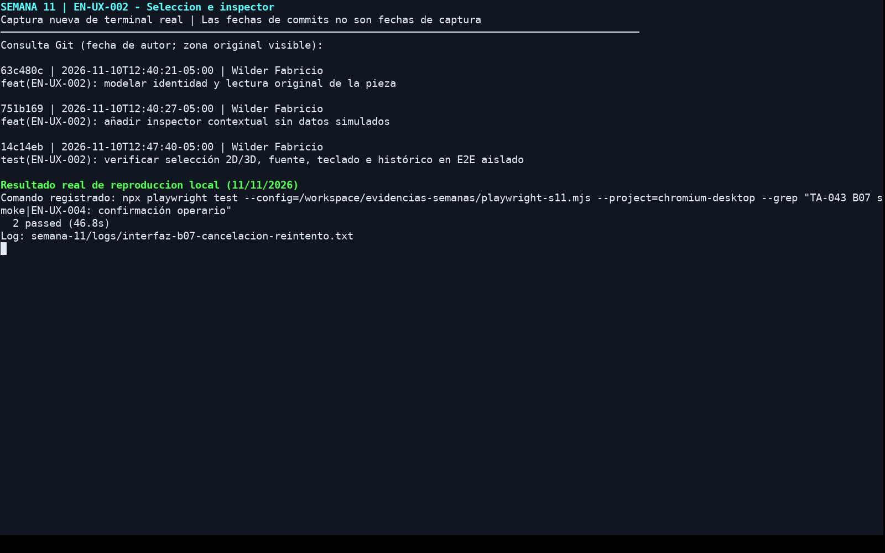

*Captura de terminal real: commits y resultados de la reproducción local.*

### EN-UX-003 — Recuperación histórica y claridad visual

#### T01 — Unificar idioma, identificadores y fondo de resultados

Se fijaron idioma y título, se conservaron códigos internos con alias legibles de motores y se ajustó el fondo para resultados extensos.

**Comprobación:** Commits y capturas verificados; B07 pasó con la interfaz actual.

**Commits de soporte:**

- [d2b145d1cc](https://github.com/melendezzz26/newglass-frontend/commit/d2b145d1cc9613ae1d871fb9d80576fde2b5463b) — newglass-frontend · d2b145d1cc · 2026-11-10 · Wilder Fabricio · fix(EN-UX-003): localizar idioma y título de NewGlass · integrado en origin/main
- [f6fc78115f](https://github.com/melendezzz26/newglass-frontend/commit/f6fc78115f5bd6cbb3c6fee4abab9357db0c3750) — newglass-frontend · f6fc78115f · 2026-11-10 · Wilder Fabricio · fix(EN-UX-003): mostrar código y alias de motores sin cambiar contratos · integrado en origin/main
- [401071fe73](https://github.com/melendezzz26/newglass-frontend/commit/401071fe739d08d17230c126a9fc8c82433cc819) — newglass-frontend · 401071fe73 · 2026-11-10 · Wilder Fabricio · fix(EN-UX-003): mantener fondo durante resultados extensos · integrado en origin/main

**Evidencias:**

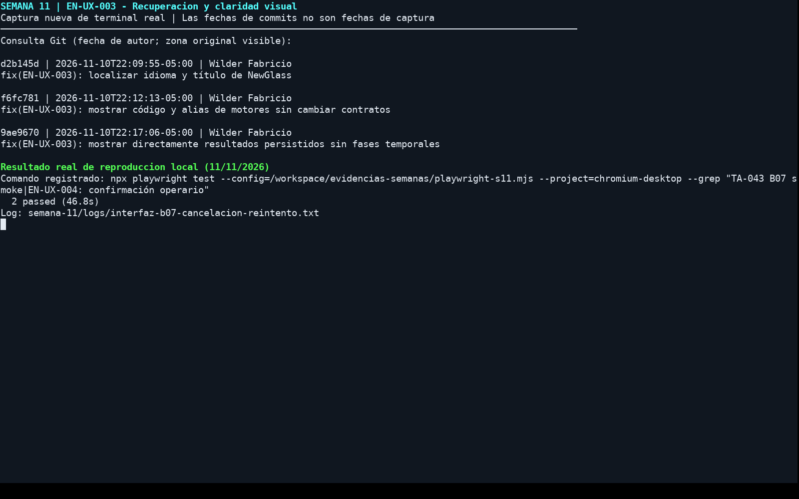

*Captura de terminal real: commits y resultados de la reproducción local.*

*Códigos y alias visibles sin alterar el contrato de motores.*

#### T02 — Recuperar patrones históricos sin fases temporales inexistentes

Se ajustó la recuperación para mostrar resultados persistidos cuando las máscaras y eventos transitorios ya no están disponibles.

**Comprobación:** B07 comprobó recuperación de la comparación y resultados. El código capturado muestra el cambio concreto de la revisión 9ae9670.

**Commits de soporte:**

- [9ae96706b5](https://github.com/melendezzz26/newglass-frontend/commit/9ae96706b547ea8e847d5f9ecc89d0fae5f2f213) — newglass-frontend · 9ae96706b5 · 2026-11-10 · Wilder Fabricio · fix(EN-UX-003): mostrar directamente resultados persistidos sin fases temporales · integrado en origin/main
- [12570ad596](https://github.com/melendezzz26/newglass-frontend/commit/12570ad596d30187abafdf6e89cd803aec97f3d1) — newglass-frontend · 12570ad596 · 2026-11-10 · Wilder Fabricio · test(EN-UX-003): recuperar patrón histórico sin pulsar fases transitorias · integrado en origin/main
- [cbba36fa6d](https://github.com/melendezzz26/newglass-frontend/commit/cbba36fa6d9e2b0f2d508ea9770f7c51001cd776) — newglass-frontend · cbba36fa6d · 2026-11-11 · Wilder Fabricio · fix(EN-UX-003): derivar fase histórica sin setState sincrónico en efecto · integrado en origin/main

**Evidencias:**

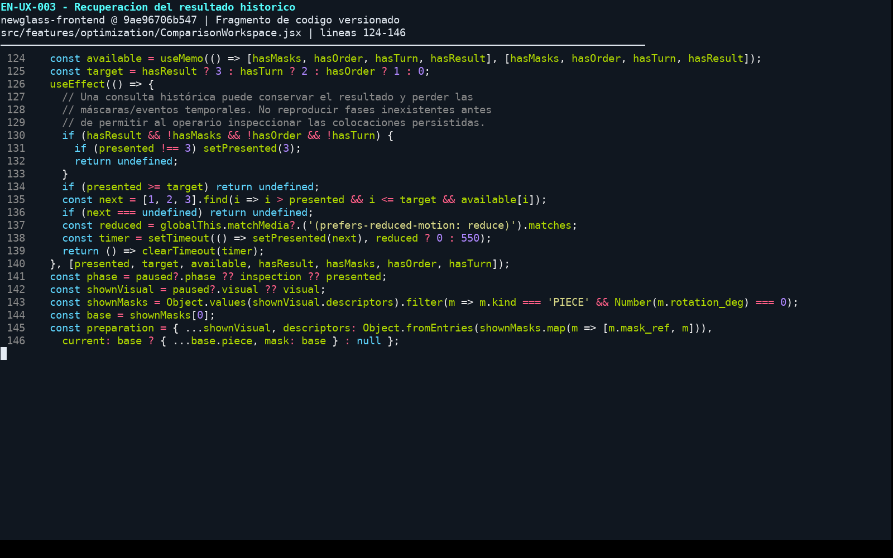

*Cambio para evitar reproducir fases inexistentes del histórico.*

*Comparación restaurada desde datos guardados.*

*Captura de terminal real: commits y resultados de la reproducción local.*

### EN-UX-004 — Cancelación segura de optimización

#### T01 — Implementar cancelación durable e idempotente en backend

Se incorporaron solicitud durable, control de versión y cierre supervisado antes de liberar la admisión, preservando resultados terminados.

**Comprobación:** 32 pruebas de supervisión aprobadas y escenario E2E con worker spawn real controlado. No se sustituyó la respuesta HTTP de cancelación con mocks.

**Commits de soporte:**

- [b24d612018](https://github.com/melendezzz26/newglass-backend/commit/b24d612018d3209cf194f25d1b8f09b5ac647e4f) — newglass-backend · b24d612018 · 2026-11-11 · Wilder Fabricio · docs(EN-UX-004): formalizar endpoint, idempotencia y cierre verificado en contrato v2 · integrado en origin/main
- [3e0c639776](https://github.com/melendezzz26/newglass-backend/commit/3e0c639776258d85a23d05aa17ae9335f0842242) — newglass-backend · 3e0c639776 · 2026-11-11 · Wilder Fabricio · test(EN-UX-004): proteger resultados FF al cancelar BF y carrera con cierre natural · integrado en origin/main
- [8c32853939](https://github.com/melendezzz26/newglass-backend/commit/8c328539392492fdb2995bcc7788306f40c4cf66) — newglass-backend · 8c32853939 · 2026-11-11 · Wilder Fabricio · test(EN-UX-004): habilitar worker real controlado solo en servidor E2E loopback · integrado en origin/main

**Evidencias:**

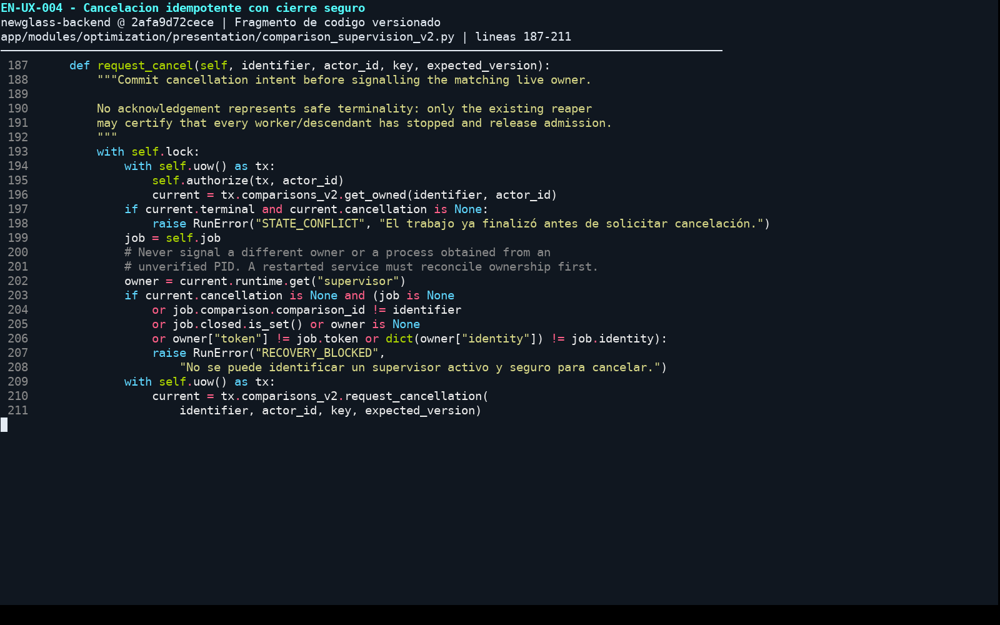

*Solicitud de cancelación y control de versión en el coordinador.*

*Captura de terminal real: commits y resultados de la reproducción local.*

#### T02 — Confirmar cancelación y comunicar estado al operario

Se incorporaron botón accesible, confirmación explícita y mensajes que distinguen cancelación voluntaria de error técnico, con título de cierre seguro.

**Comprobación:** El E2E de cancelación pasó; se conservaron capturas del diálogo, aviso confirmado y motor cancelado.

**Commits de soporte:**

- [2cf6bcd061](https://github.com/melendezzz26/newglass-frontend/commit/2cf6bcd0612f4f68ea0507eb5de35bbba1913bf8) — newglass-frontend · 2cf6bcd061 · 2026-11-11 · Wilder Fabricio · feat(EN-UX-004): botón accesible y modal para cancelación confirmada por backend · integrado en origin/main
- [71aed8a1c9](https://github.com/melendezzz26/newglass-frontend/commit/71aed8a1c95dadb74c15f34b2e7d3268b5bc3019) — newglass-frontend · 71aed8a1c9 · 2026-11-11 · Wilder Fabricio · fix(EN-UX-004): separar motores cancelados de fallos técnicos en resumen · integrado en origin/main
- [f428f84fd0](https://github.com/melendezzz26/newglass-frontend/commit/f428f84fd0209da37f336504578ecff98515ba09) — newglass-frontend · f428f84fd0 · 2026-11-11 · Wilder Fabricio · fix(EN-UX-004): titular el aviso de cierre seguro sin sugerir éxito del cálculo · integrado en origin/main
- [b78211f550](https://github.com/melendezzz26/newglass-frontend/commit/b78211f55061eeeee483effef5679f227893c07e) — newglass-frontend · b78211f550 · 2026-11-11 · Wilder Fabricio · test(EN-UX-004): verificar título global real en Playwright desktop y móvil · integrado en origin/main

**Evidencias:**

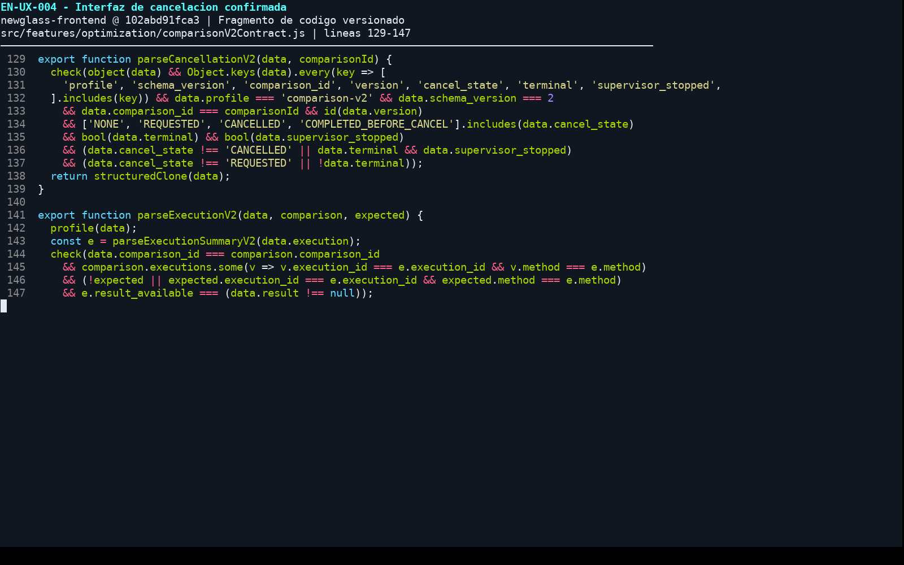

*Validación del contrato de cancelación y cierre seguro.*

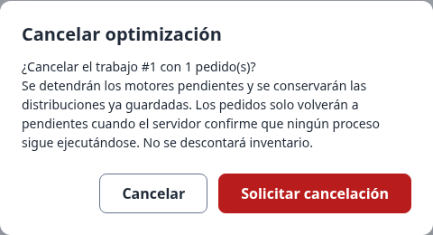

*Diálogo antes de solicitar la cancelación.*

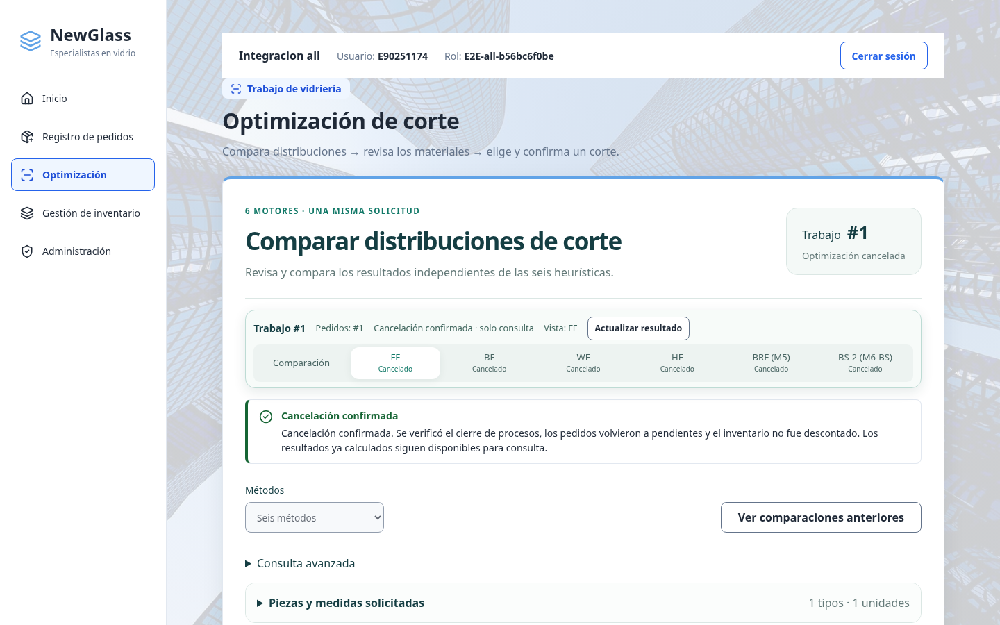

*Aviso real después del cierre verificado.*

#### T03 — Probar reintentos, carreras y recuperación

Se cubrieron idempotencia, doble solicitud, cancelación durante BF que conserva FF, carrera con cierre natural y recuperación durable.

**Comprobación:** 32 pruebas del supervisor y dos escenarios E2E aprobados; la captura del motor FF verifica la lectura después de la cancelación.

**Alcance:** El entorno no expone /proc/<pid>/task/<pid>/children. El test específico de descubrimiento de descendientes falló durante la preparación previa; estas capturas y los 32 tests no acreditan esa capacidad ausente ni certifican un despliegue.

**Commits de soporte:**

- [3e0c639776](https://github.com/melendezzz26/newglass-backend/commit/3e0c639776258d85a23d05aa17ae9335f0842242) — newglass-backend · 3e0c639776 · 2026-11-11 · Wilder Fabricio · test(EN-UX-004): proteger resultados FF al cancelar BF y carrera con cierre natural · integrado en origin/main
- [b6496d1b40](https://github.com/melendezzz26/newglass-frontend/commit/b6496d1b406817099d5a4363beb238b19915192f) — newglass-frontend · b6496d1b40 · 2026-11-11 · Wilder Fabricio · test(EN-UX-004): proteger doble clic y reconexión con idempotencia estable · integrado en origin/main
- [03e9dce65d](https://github.com/melendezzz26/newglass-frontend/commit/03e9dce65d4db8ad90afab00067af8c33243e88a) — newglass-frontend · 03e9dce65d · 2026-11-11 · Wilder Fabricio · test(EN-UX-004): regresión de carrera de versión durante solicitud de cancelación · integrado en origin/main
- [2718dab81b](https://github.com/melendezzz26/newglass-frontend/commit/2718dab81b404eb14fdb82df3c48b61e52cf573d) — newglass-frontend · 2718dab81b · 2026-11-11 · Wilder Fabricio · test(EN-UX-004): verificar cancelación HTTP real en Playwright desktop/mobile con worker controlado · integrado en origin/main

**Evidencias:**

*Captura de terminal real: commits y resultados de la reproducción local.*

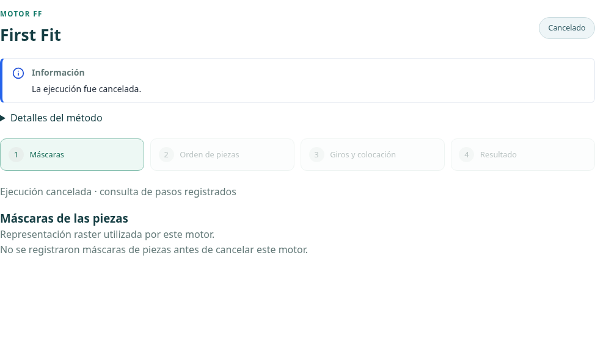

*Estado de ejecución conservado después de cancelar.*
