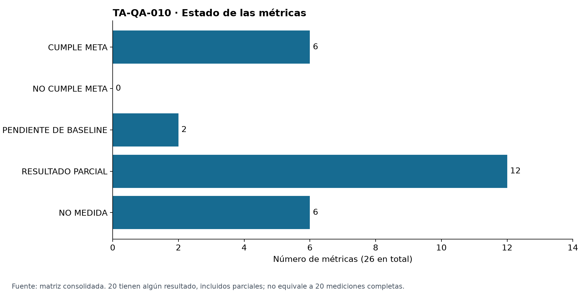
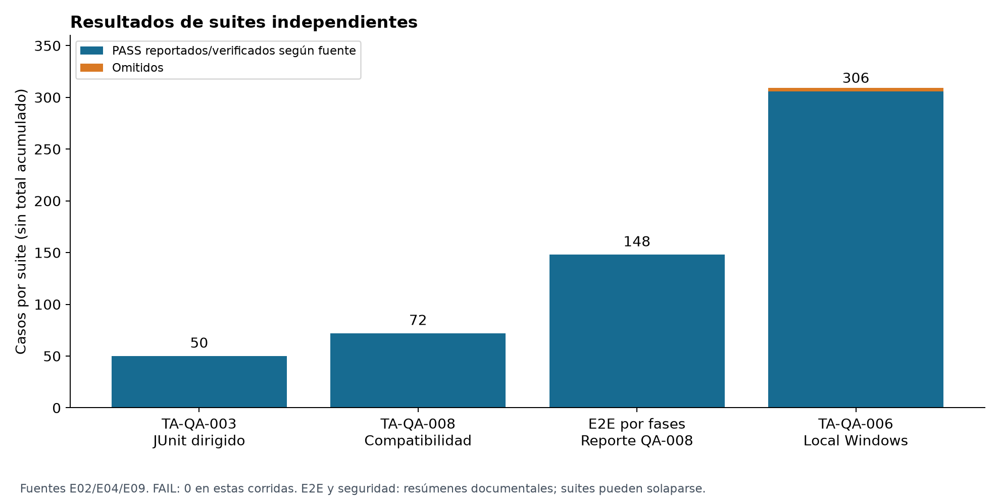
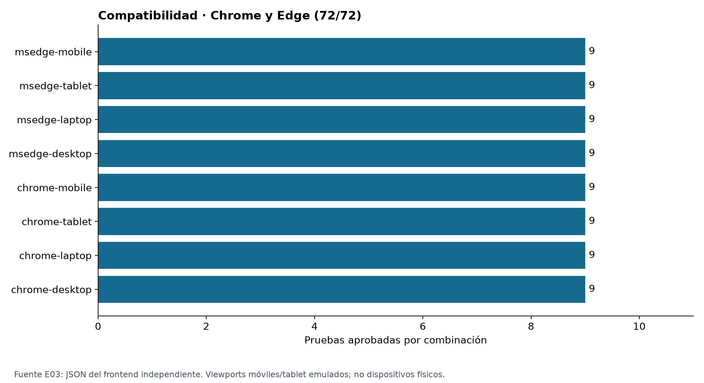
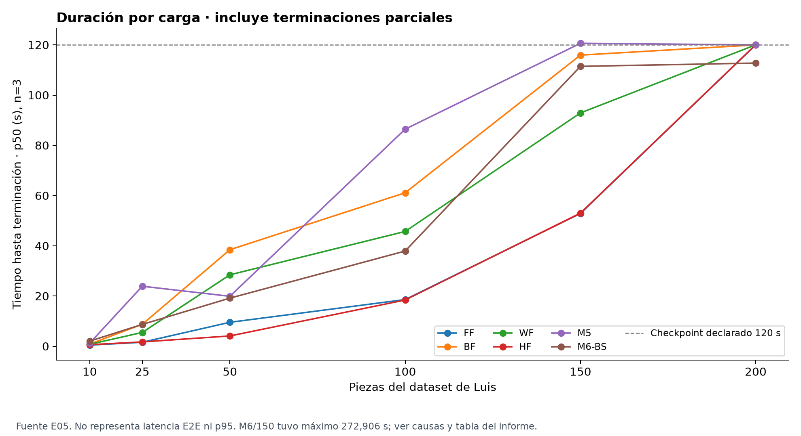
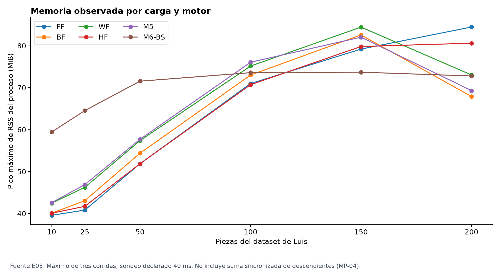
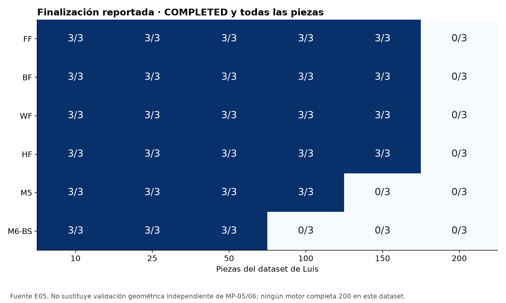
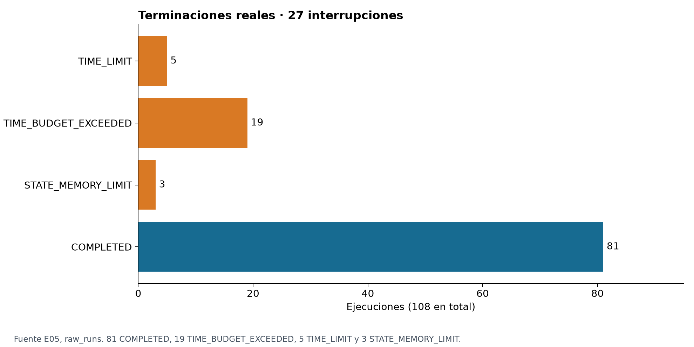

# NEWGLASS — TA-QA-010: Informe cuantitativo ISO

Fecha de corte: 11 de noviembre de 2026 (America/Bogota). Sprint 2. Tarea oficial: **T01 — Consolidar evidencia**.

Equipo: Andro Joseph Quispe Cesias; Fabricio Danniel Aguilar Chavez; Fabricio Melendez Quezada; Luis Anthony Ibanez Herrera.
Scrum Master: Fabricio Danniel Aguilar Chavez (`fabrilar1`). Estado: **BORRADOR — pendiente de aportes y revisión final del equipo**.

## 1. Resumen ejecutivo

NewGlass fue evaluado mediante métricas alineadas con ISO/IEC 25010 e ISO/IEC 25023. De las 26 métricas definidas, 20 tienen algún resultado disponible, incluidos resultados parciales o no aceptables como medición completa: 6 cumplen meta en la muestra, 0 incumplimientos cuantitativos concluyentes, 2 pendientes de baseline, 12 resultados parciales y 6 no medidas. Estas categorías suman 26; «con resultado» es un subtotal transversal, no una categoría adicional.

Las pruebas funcionales dirigidas y la matriz Chrome/Edge alcanzaron sus metas en muestras controladas. La carga registra 81 de 108 ejecuciones reportadas completas y 27 interrupciones. M6 alcanza 3/3 completas hasta 50 piezas en el dataset de Luis; no se afirma capacidad universal de 200 u 800 piezas. Persisten brechas de p95, memoria, usabilidad, mantenibilidad y denominadores operativos. Cero métricas clasificadas NO CUMPLE META no significa ausencia de fallos: rendimiento tiene metas Baseline y sus interrupciones se muestran explícitamente.

## 2. Objetivo, alcance y ubicación

Consolidar hallazgos y resultados medidos con trazabilidad a normas y pruebas reproducibles. Se auditaron los tres repositorios, ramas publicadas, PR abiertos/integrados y evidencia versionada. No se ejecutaron pruebas del producto, benchmarks, capturas, cambios funcionales ni consultas a bases de datos.

Repositorio documental: `melendezzz26/optimizador-vidrio`, base `integration-02`. **Ubicacion provisional de documentacion transversal hasta que el equipo defina ownership definitivo.** EN-REPO-001 deja pendiente la estrategia compartida y ambos MIGRATION mantienen el legado como fuente anterior al corte ([E15](https://github.com/melendezzz26/optimizador-vidrio/blob/b8b55ad831c229dfefc321747003da686d8a1a60/docs/specs/PLAN-EN-REPO-001-separacion-repositorios.md) [E16](https://github.com/melendezzz26/newglass-frontend/blob/1868759b733a5798cf47307d6c1dffbd730e43a0/docs/MIGRATION.md) [E17](https://github.com/melendezzz26/newglass-backend/blob/2afa9d72cecee74d4c61187ff15c74564e7dde3f/docs/MIGRATION.md)). No se duplica el informe en frontend/backend. Se usa integration-02, base de los PR documentales #111, #114 y #120, en vez de main histórico.

## 3. Marco de referencia

[ISO/IEC 25010:2023](https://www.iso.org/standard/78176.html) define un modelo de calidad de producto de nueve características. [ISO/IEC 25023:2016](https://www.iso.org/standard/35747.html) proporciona medidas para evaluación cuantitativa. Las fórmulas y metas usadas son propuestas operativas del proyecto, no transcripciones ni umbrales impuestos por ISO. Las ediciones difieren; safety y flexibilidad requieren mapeo explícito del equipo. Trazabilidad es indicador operativo, no característica ISO independiente. Security y safety se reportan por separado. No se afirma certificación, acreditación ni conformidad completa.

EN-QA-001 de Aguilar aporta el modelo y señala revisar la clasificación de MC-01 y MU-04/05. Se preservan las etiquetas de la matriz base para no cambiar su definición durante la consolidación; el mapeo final queda en A01. [E08](https://github.com/melendezzz26/optimizador-vidrio/blob/02bc2ef97411eaf00e56104cc9f82cd983b18fb4/docs/quality/ISO-25010-modelo-calidad.md)

## 4. Metodología y calidad de evidencia

Se verificaron JSON, JUnit, protocolos, scripts de medición y metadatos GitHub. Se fijan enlaces a commits para evitar que una rama cambiante altere la fuente. Los README sin datos crudos se identifican como evidencia documental secundaria. No se infiere ejecución por la mera existencia de un test ni revisión humana por un merge.

Matriz corregida: SHA `f3ac2616754f05cab8fa2e6e194f9e39156dea30` del PR #120 **abierto**; 26 IDs únicos, 19 fórmulas porcentuales con `* 100`, p50 en posición `ceil(0,50*n)` y p95 `ceil(0,95*n)` con n>=100. Posiciones basadas en 1 sobre datos ordenados. Las 26 metas coinciden exactamente con integration-02. No se modifica la matriz original en este PR. [E01](https://github.com/melendezzz26/optimizador-vidrio/blob/f3ac2616754f05cab8fa2e6e194f9e39156dea30/docs/quality/TA-QA-001-matriz-metricas-iso25023.md)

Se recalculó p50 de cada grupo de tres datos crudos; coincide con el resumen dentro de 0,001 s. No se acepta el p95 interpolado del productor como MP-03. No se suman 50 casos, 26 patrones, 6 políticas ni las suites 554/564: son unidades o selecciones solapadas. Tampoco se suman MC-01/02/03 con 72 compatibilidad o 148 E2E como pruebas únicas.

Estados: CUMPLE META y NO CUMPLE META requieren medición suficiente para la meta en la muestra. PENDIENTE DE BASELINE indica datos iniciales sin baseline comparable acordado. RESULTADO PARCIAL indica evidencia útil con brechas de protocolo/denominador. NO MEDIDA indica ausencia de medición verificable, aun si existe un PASS declarado. Denominador desconocido/cero nunca equivale a 100%.

## 5. Matriz consolidada: métricas, metas y resultados (CA-01)

| ID métrica | Característica | Métrica | Fórmula | Meta | Resultado real | Estado | Evidencia | Responsable |
|---|---|---|---|---|---|---|---|---|
| MF-01 | Funcional | Casos correctos | PASS / ejecutados * 100 | 100% criticos | 50/50 = 100% en batería dirigida | CUMPLE META | [E02](https://github.com/melendezzz26/optimizador-vidrio/blob/02bc2ef97411eaf00e56104cc9f82cd983b18fb4/docs/evidence/sprint-02/TA-QA-003/README.md) | Andro / Melendez |
| MF-02 | Funcional | Validez geometrica | patrones validos / generados * 100 | 100% criticos | 26/26 = 100% patrones seleccionados | CUMPLE META | [E02](https://github.com/melendezzz26/optimizador-vidrio/blob/02bc2ef97411eaf00e56104cc9f82cd983b18fb4/docs/evidence/sprint-02/TA-QA-003/README.md) | Andro / Melendez |
| MF-03 | Funcional | Politica de FF BF WF M4 M5 M6 | casos de politica correctos / evaluados * 100 | 100% controlados | 6/6 = 100% políticas con caso controlado; M6 no exhaustivo | CUMPLE META | [E02](https://github.com/melendezzz26/optimizador-vidrio/blob/02bc2ef97411eaf00e56104cc9f82cd983b18fb4/docs/evidence/sprint-02/TA-QA-003/README.md) | Andro / Melendez |
| MP-01 | Desempeno | Latencia | fin menos inicio | Baseline | 108 duraciones; 36 combinaciones; ver CSV. Windows, baseline Linux pendiente | PENDIENTE DE BASELINE | [E05](https://github.com/melendezzz26/optimizador-vidrio/blob/820779c4377012a849e0402f1f92a638710705a5/docs/evidence/sprint-02/TA-QA-002/raw_results.json) | Luis / Melendez |
| MP-02 | Desempeno | p50 | valor ordenado en posicion ceil(0,50 * n) | Baseline | 36 p50 recalculados por rango más cercano, n=3; coinciden a 0,001 s | PENDIENTE DE BASELINE | [E05](https://github.com/melendezzz26/optimizador-vidrio/blob/820779c4377012a849e0402f1f92a638710705a5/docs/evidence/sprint-02/TA-QA-002/raw_results.json) | Luis / Melendez |
| MP-03 | Desempeno | p95 | valor ordenado en posicion ceil(0,95 * n), n >= 100 | Baseline | n=3 por combinación; n>=100 requerido. p95 publicado no aceptado | RESULTADO PARCIAL | [E05](https://github.com/melendezzz26/optimizador-vidrio/blob/820779c4377012a849e0402f1f92a638710705a5/docs/evidence/sprint-02/TA-QA-002/raw_results.json) | Luis / Melendez |
| MP-04 | Desempeno | Pico RSS | maximo de sumas de RSS sincronizadas de proceso y descendientes | Baseline | Picos RSS de proceso por combinación en CSV; no suma sincronizada con descendientes | RESULTADO PARCIAL | [E05](https://github.com/melendezzz26/optimizador-vidrio/blob/820779c4377012a849e0402f1f92a638710705a5/docs/evidence/sprint-02/TA-QA-002/raw_results.json) | Luis / Melendez |
| MP-05 | Fiabilidad | Ejecuciones completas | completas validas / iniciadas * 100 | Baseline | 81/108 = 75% reportadas completas; falta oráculo de validez para la fórmula | RESULTADO PARCIAL | [E05](https://github.com/melendezzz26/optimizador-vidrio/blob/820779c4377012a849e0402f1f92a638710705a5/docs/evidence/sprint-02/TA-QA-002/raw_results.json) | Luis / Melendez |
| MP-06 | Desempeno | Capacidad observada | mayor escala con todas las repeticiones completas y validas | Baseline | Mayor carga con 3/3 completas: FF/BF/WF/HF 150; M5 100; M6 50; validez pendiente | RESULTADO PARCIAL | [E05](https://github.com/melendezzz26/optimizador-vidrio/blob/820779c4377012a849e0402f1f92a638710705a5/docs/evidence/sprint-02/TA-QA-002/raw_results.json) | Luis / Melendez |
| MU-01 | Interaccion | Tareas completadas | completadas / intentadas * 100 | Baseline | Reporte 9/9; arnés marca completado aun sin ejecutar algunos pasos; no validar 100% | RESULTADO PARCIAL | [E06](https://github.com/melendezzz26/optimizador-vidrio/blob/3bf682056cb4bfe56214d545dd05faf866370cf7/docs/evidence/sprint-02/TA-QA-005/README.md) | Luis |
| MU-02 | Interaccion | Tiempo por tarea | fin menos inicio por intento | Baseline | Nueve tiempos reportados 0,00–4,85 s; automatización, no estudio con participantes | RESULTADO PARCIAL | [E06](https://github.com/melendezzz26/optimizador-vidrio/blob/3bf682056cb4bfe56214d545dd05faf866370cf7/docs/evidence/sprint-02/TA-QA-005/README.md) | Luis |
| MU-03 | Interaccion | Tasa de errores | intentos con error / intentos * 100 | Baseline | Reporte 0/9 errores; varios valores fijados en cero; falta catálogo y captura fiable | RESULTADO PARCIAL | [E06](https://github.com/melendezzz26/optimizador-vidrio/blob/3bf682056cb4bfe56214d545dd05faf866370cf7/docs/evidence/sprint-02/TA-QA-005/README.md) | Luis |
| MU-04 | Interaccion | Navegacion por teclado | pasos accesibles / pasos evaluados * 100 | 100% criticos | PASS declarado sin denominadores ni aserciones suficientes de teclado/foco | NO MEDIDA | [E06](https://github.com/melendezzz26/optimizador-vidrio/blob/3bf682056cb4bfe56214d545dd05faf866370cf7/docs/evidence/sprint-02/TA-QA-005/README.md) | Luis |
| MU-05 | Interaccion | Foco correcto | transiciones correctas / transiciones evaluadas * 100 | 100% criticas | PASS declarado sin denominadores ni aserciones suficientes de teclado/foco | NO MEDIDA | [E06](https://github.com/melendezzz26/optimizador-vidrio/blob/3bf682056cb4bfe56214d545dd05faf866370cf7/docs/evidence/sprint-02/TA-QA-005/README.md) | Luis |
| MC-01 | Compatibilidad | Navegadores | combinaciones exitosas / evaluadas * 100 | 100% acordadas | 8/8 = 100% combinaciones Chrome/Edge y viewport | CUMPLE META | [E03](https://github.com/melendezzz26/newglass-frontend/blob/1868759b733a5798cf47307d6c1dffbd730e43a0/docs/evidence/sprint-02/TA-QA-008/resultados-newglass-frontend.json) [E04](https://github.com/melendezzz26/newglass-frontend/blob/1868759b733a5798cf47307d6c1dffbd730e43a0/docs/evidence/sprint-02/TA-QA-008/README.md) | Andro |
| MC-02 | Flexibilidad | Responsive | pantallas sin perdida / pantallas evaluadas * 100 | 100% criticas | 56/56 = 100% observaciones de controles seleccionados | CUMPLE META | [E03](https://github.com/melendezzz26/newglass-frontend/blob/1868759b733a5798cf47307d6c1dffbd730e43a0/docs/evidence/sprint-02/TA-QA-008/resultados-newglass-frontend.json) [E04](https://github.com/melendezzz26/newglass-frontend/blob/1868759b733a5798cf47307d6c1dffbd730e43a0/docs/evidence/sprint-02/TA-QA-008/README.md) | Andro |
| MC-03 | Flexibilidad | Flujos por viewport | flujos exitosos / flujos evaluados * 100 | 100% criticos | 48/48 = 100% flujos; CF-04/05 comparten prueba | CUMPLE META | [E03](https://github.com/melendezzz26/newglass-frontend/blob/1868759b733a5798cf47307d6c1dffbd730e43a0/docs/evidence/sprint-02/TA-QA-008/resultados-newglass-frontend.json) [E04](https://github.com/melendezzz26/newglass-frontend/blob/1868759b733a5798cf47307d6c1dffbd730e43a0/docs/evidence/sprint-02/TA-QA-008/README.md) | Andro |
| MM-01 | Mantenibilidad | Cobertura | lineas ejecutadas / lineas medibles * 100 | Baseline | Sin medición verificable | NO MEDIDA | [E08](https://github.com/melendezzz26/optimizador-vidrio/blob/02bc2ef97411eaf00e56104cc9f82cd983b18fb4/docs/quality/ISO-25010-modelo-calidad.md) | Melendez |
| MM-02 | Mantenibilidad | Duplicacion | lineas duplicadas / lineas analizadas * 100 | Baseline | Sin medición verificable | NO MEDIDA | [E08](https://github.com/melendezzz26/optimizador-vidrio/blob/02bc2ef97411eaf00e56104cc9f82cd983b18fb4/docs/quality/ISO-25010-modelo-calidad.md) | Melendez |
| MM-03 | Mantenibilidad | Complejidad | complejidad ciclomatica por funcion | Baseline | Sin medición verificable | NO MEDIDA | [E08](https://github.com/melendezzz26/optimizador-vidrio/blob/02bc2ef97411eaf00e56104cc9f82cd983b18fb4/docs/quality/ISO-25010-modelo-calidad.md) | Melendez |
| MM-04 | Mantenibilidad | CI | ejecuciones exitosas / terminadas * 100 | Baseline | Sin medición verificable | NO MEDIDA | [E08](https://github.com/melendezzz26/optimizador-vidrio/blob/02bc2ef97411eaf00e56104cc9f82cd983b18fb4/docs/quality/ISO-25010-modelo-calidad.md) | Melendez |
| MS-01 | Seguridad operacional | Rechazo de invalidos | invalidos rechazados / invalidos evaluados * 100 | 100% | 8/8 grupos rechazados; mezcla verificaciones de dominio y HTTP; denominador atómico pendiente | RESULTADO PARCIAL | [E07](https://github.com/melendezzz26/optimizador-vidrio/blob/06d2df49e0b24c44073d56f79ca6e6d442bcbbfc/backend/scripts/results_ta_qa_009.json) | Luis / Melendez |
| MS-02 | Seguridad operacional | Falsa aceptacion | invalidos aceptados / invalidos evaluados * 100 | 0% | 0/8 grupos con aceptación observada; no demuestra cero fugas en confirmación E2E | RESULTADO PARCIAL | [E07](https://github.com/melendezzz26/optimizador-vidrio/blob/06d2df49e0b24c44073d56f79ca6e6d442bcbbfc/backend/scripts/results_ta_qa_009.json) | Luis / Melendez |
| MS-03 | Seguridad operacional | Margen y separacion | patrones que cumplen ambos / evaluados * 100 | 100% | Casos de margen/separación rechazados y 26 patrones válidos; falta conjunto MS específico | RESULTADO PARCIAL | [E07](https://github.com/melendezzz26/optimizador-vidrio/blob/06d2df49e0b24c44073d56f79ca6e6d442bcbbfc/backend/scripts/results_ta_qa_009.json) [E02](https://github.com/melendezzz26/optimizador-vidrio/blob/02bc2ef97411eaf00e56104cc9f82cd983b18fb4/docs/evidence/sprint-02/TA-QA-003/README.md) [E10](https://github.com/melendezzz26/newglass-frontend/blob/1868759b733a5798cf47307d6c1dffbd730e43a0/docs/evidence/TA-045/README.md) | Luis / Melendez |
| MT-01 | Operativa | Material identificable | materiales con codigo visible / utilizados * 100 | 100% | 6 smoke desktop/mobile y seis motores; plancha por ID, sin denominador de materiales | RESULTADO PARCIAL | [E12](https://github.com/melendezzz26/newglass-frontend/blob/1868759b733a5798cf47307d6c1dffbd730e43a0/docs/evidence/HU-MAT-001/README.md) | Andro / Melendez |
| MT-02 | Operativa | Origen pieza sobrante | relaciones trazables / evaluadas * 100 | 100% | Relación fuente-pieza-sobrante persistida en caso de dos fuentes; sin denominador de relaciones | RESULTADO PARCIAL | [E12](https://github.com/melendezzz26/newglass-frontend/blob/1868759b733a5798cf47307d6c1dffbd730e43a0/docs/evidence/HU-MAT-001/README.md) | Andro / Melendez |

## 6. Resultado esperado frente al obtenido

| Tarea | Resultado esperado | Resultado obtenido | Estado | Observación |
|---|---|---|---|---|
| TA-QA-001 | 26 fórmulas/metas consistentes | 26; 19 porcentajes *100; p50/p95 corregidos | RESULTADO PARCIAL | PR #120 abierto; metas idénticas a base |
| TA-QA-003 | 100% en muestra dirigida | 50/50 casos; 26/26 patrones; 6/6 políticas | CUMPLE META | Muestras y unidades diferentes; no sumar |
| TA-QA-008 | 100% combinaciones acordadas | 72/72 pruebas; MC 8/8, 56/56 y 48/48 | CUMPLE META | Indicadores solapados; E2E 148/148 separado |
| TA-QA-002 | Baseline comparable y p95 con n>=100 | 108 ejecuciones, 36 combinaciones, n=3; 81 completas declaradas | RESULTADO PARCIAL | No generalizar capacidad a 200 piezas |
| TA-QA-005 | Tareas, tiempos, errores, teclado y foco medidos | 9 escenarios declarados; datos y aserciones insuficientes | RESULTADO PARCIAL | No aceptar 100% accesibilidad |
| TA-QA-007 | Cobertura, duplicación, complejidad y CI | No se localizaron resultados específicos | NO MEDIDA | Pendiente de aportes de Melendez |
| TA-QA-009 | Rechazos y restricciones verificables | 8 grupos rechazados, 0 escapes reportados | RESULTADO PARCIAL | Alcance dominio/HTTP, no seguridad física |
| TA-045 | Separación configurable respetada y visible | 203 PASS focalizados; configuración visible | RESULTADO PARCIAL | Suite técnica; no denominador ISO nuevo |
| TA-047 | Rechazo sin mutación y recuperación previa | 363 PASS Windows, 129 Linux; UI conserva resultado | RESULTADO PARCIAL | Selecciones solapadas; no sumarlas |
| HU-MAT-001 | Identidad y relaciones trazables | 6 smoke; caso de dos fuentes confirmado e historial | RESULTADO PARCIAL | MT-01/02 sin denominadores |
| EN-QA-001 / TA-QA-006 | Modelo y accesos revisados | 9 características; 306 PASS y 3 skips locales; CI verde | RESULTADO PARCIAL | Aporte Aguilar; métricas MSEG fuera de las 26 |
| ACADEMIC-800 | M6 nativo y carga sintética controlada | 18 ejecuciones de 600/700/800 completas | RESULTADO PARCIAL | Aporte Melendez; dataset pequeño distinto |

## 7. Resultados por característica e interpretación (CA-03)

### Adecuación funcional

MF-01 50/50, MF-02 26/26 y MF-03 6/6 alcanzan las metas en sus muestras. JUnit verifica los 50 casos dirigidos. La regresión original es 554 PASS; el documento post-merge reporta 564 PASS tras incorporar más pruebas, sin XML nuevo localizado en esa referencia. Se conserva 564 como resultado documental secundario y no se grafica como nueva suite única. M6 tiene pruebas de independencia y exploración acotada, no de optimalidad global. [E02](https://github.com/melendezzz26/optimizador-vidrio/blob/02bc2ef97411eaf00e56104cc9f82cd983b18fb4/docs/evidence/sprint-02/TA-QA-003/README.md) [E14](https://github.com/melendezzz26/optimizador-vidrio/blob/53b5e66ff2436f6d6d7f6f1a624660717e25bfcf/docs/evidence/sprint-02/TA-QA-003/post-merge.md)

### Eficiencia de desempeño y fiabilidad

El archivo de Luis tiene 36 combinaciones (seis motores × seis cargas), tres repeticiones cada una: 108 registros. Se conservan todos, incluidos 19 TIME_BUDGET_EXCEEDED, 5 TIME_LIMIT y 3 STATE_MEMORY_LIMIT. 81/108=75% es finalización declarada, no MP-05 validada con oráculo independiente. M6/100 coloca 58/100; M6/200 44/200; en M6/150 dos repeticiones colocan 47/150 y una termina por presupuesto a 272,906 s. Su resumen por grupo oculta esa causa mixta: aquí se conserva.

La mayor carga con 3/3 COMPLETED es 150 para FF/BF/WF/HF, 100 para M5 y 50 para M6. Es capacidad observada bajo las condiciones evaluadas, pendiente de revalidación geométrica para MP-06. Ningún motor completa 200 en este dataset. No se incorpora 300 como medición nueva: el JSON solo tiene 10,25,50,100,150,200. No se reproduce la atribución de timeouts HTTP/Heroku del README sin trazas correlacionadas.

| Piezas | Motor | n | p50 (s) | Máximo (s) | RSS proceso (MiB) | Completas declaradas | Estados crudos |
|---|---|---|---|---|---|---|---|
| 10 | FF | 3 | 0.453 | 0.453 | 39.58 | 3/3 | COMPLETED: 3 |
| 10 | BF | 3 | 0.86 | 0.875 | 40.09 | 3/3 | COMPLETED: 3 |
| 10 | WF | 3 | 0.766 | 0.797 | 42.46 | 3/3 | COMPLETED: 3 |
| 10 | HF | 3 | 0.609 | 0.61 | 40.07 | 3/3 | COMPLETED: 3 |
| 10 | M5 | 3 | 1.218 | 1.219 | 42.58 | 3/3 | COMPLETED: 3 |
| 10 | M6-BS | 3 | 2.031 | 2.109 | 59.43 | 3/3 | COMPLETED: 3 |
| 25 | FF | 3 | 1.578 | 1.594 | 40.82 | 3/3 | COMPLETED: 3 |
| 25 | BF | 3 | 8.734 | 8.828 | 43.05 | 3/3 | COMPLETED: 3 |
| 25 | WF | 3 | 5.484 | 5.703 | 46.24 | 3/3 | COMPLETED: 3 |
| 25 | HF | 3 | 1.719 | 1.75 | 41.72 | 3/3 | COMPLETED: 3 |
| 25 | M5 | 3 | 23.89 | 24.0 | 46.89 | 3/3 | COMPLETED: 3 |
| 25 | M6-BS | 3 | 8.688 | 21.782 | 64.54 | 3/3 | COMPLETED: 3 |
| 50 | FF | 3 | 9.532 | 9.625 | 51.88 | 3/3 | COMPLETED: 3 |
| 50 | BF | 3 | 38.438 | 43.297 | 54.39 | 3/3 | COMPLETED: 3 |
| 50 | WF | 3 | 28.438 | 29.657 | 57.39 | 3/3 | COMPLETED: 3 |
| 50 | HF | 3 | 4.094 | 4.109 | 51.88 | 3/3 | COMPLETED: 3 |
| 50 | M5 | 3 | 19.891 | 19.922 | 57.71 | 3/3 | COMPLETED: 3 |
| 50 | M6-BS | 3 | 19.156 | 19.25 | 71.56 | 3/3 | COMPLETED: 3 |
| 100 | FF | 3 | 18.578 | 19.079 | 70.99 | 3/3 | COMPLETED: 3 |
| 100 | BF | 3 | 61.109 | 61.781 | 73.02 | 3/3 | COMPLETED: 3 |
| 100 | WF | 3 | 45.703 | 45.906 | 75.16 | 3/3 | COMPLETED: 3 |
| 100 | HF | 3 | 18.406 | 18.593 | 70.71 | 3/3 | COMPLETED: 3 |
| 100 | M5 | 3 | 86.438 | 87.031 | 76.07 | 3/3 | COMPLETED: 3 |
| 100 | M6-BS | 3 | 37.907 | 37.922 | 73.59 | 0/3 | STATE_MEMORY_LIMIT: 3 |
| 150 | FF | 3 | 52.843 | 53.328 | 79.21 | 3/3 | COMPLETED: 3 |
| 150 | BF | 3 | 115.922 | 115.968 | 82.59 | 3/3 | COMPLETED: 3 |
| 150 | WF | 3 | 92.906 | 100.734 | 84.45 | 3/3 | COMPLETED: 3 |
| 150 | HF | 3 | 53.0 | 53.328 | 79.83 | 3/3 | COMPLETED: 3 |
| 150 | M5 | 3 | 120.625 | 120.719 | 82.05 | 0/3 | TIME_BUDGET_EXCEEDED: 3 |
| 150 | M6-BS | 3 | 111.453 | 272.906 | 73.7 | 0/3 | TIME_LIMIT: 2, TIME_BUDGET_EXCEEDED: 1 |
| 200 | FF | 3 | 120.0 | 120.094 | 84.47 | 0/3 | TIME_BUDGET_EXCEEDED: 3 |
| 200 | BF | 3 | 120.0 | 120.0 | 67.9 | 0/3 | TIME_BUDGET_EXCEEDED: 3 |
| 200 | WF | 3 | 120.016 | 120.031 | 73.04 | 0/3 | TIME_BUDGET_EXCEEDED: 3 |
| 200 | HF | 3 | 120.047 | 120.047 | 80.61 | 0/3 | TIME_BUDGET_EXCEEDED: 3 |
| 200 | M5 | 3 | 120.0 | 120.016 | 69.32 | 0/3 | TIME_BUDGET_EXCEEDED: 3 |
| 200 | M6-BS | 3 | 112.75 | 112.859 | 72.8 | 0/3 | TIME_LIMIT: 3 |

ACADEMIC-800 de Melendez documenta 18 corridas completas de 600/700/800 piezas pequeñas con M6 nativo, Linux Python 3.12.14, 120 s de checkpoint. Para 800, M6 registra 106,27 s y RSS de proceso 32,89 MiB. Se usa como evidencia contextual de revisión del algoritmo, separada del dataset de piezas grandes de Luis y sin atribuir capacidad comercial de 800. S2-WF-CARGA identifica como responsable a Aguilar: no se reasigna a Melendez aunque el reporte QA-002 lo denomine así. [E05](https://github.com/melendezzz26/optimizador-vidrio/blob/820779c4377012a849e0402f1f92a638710705a5/docs/evidence/sprint-02/TA-QA-002/raw_results.json) [E13](https://github.com/melendezzz26/optimizador-vidrio/blob/02bc2ef97411eaf00e56104cc9f82cd983b18fb4/docs/evidence/sprint-02/ACADEMIC-800/README.md)

### Compatibilidad y flexibilidad

JSON verificado: 72/72, nueve pruebas por cada una de ocho combinaciones. MC-01 8/8, MC-02 56/56 y MC-03 48/48 derivan observaciones y flujos del mismo conjunto. E2E por fases 148/148 está documentado y los checks del PR #4 fueron exitosos. No son 72+8+56+48 pruebas únicas. Los controles seleccionados no cubren toda legibilidad, clipping o accesibilidad. [E03](https://github.com/melendezzz26/newglass-frontend/blob/1868759b733a5798cf47307d6c1dffbd730e43a0/docs/evidence/sprint-02/TA-QA-008/resultados-newglass-frontend.json) [E04](https://github.com/melendezzz26/newglass-frontend/blob/1868759b733a5798cf47307d6c1dffbd730e43a0/docs/evidence/sprint-02/TA-QA-008/README.md)

### Capacidad de interacción

Luis reporta nueve escenarios con 100% y tiempos 4,85; 0,51; 1,53; 2,82; 0,03; 0,04; 1,04; 0,00; 1,39 s. Se conservan como valores declarados, no baseline humano. La revisión del arnés encuentra flags de foco/teclado fijados a PASS, uso de click en tareas llamadas de teclado y T-OPT-02 marcado completo aunque no haya checkbox. No se acepta el 100% de accesibilidad ni se grafica como resultado confirmado. Falta JSON versionado de ejecución, participantes, denominadores de pasos y transiciones. [E06](https://github.com/melendezzz26/optimizador-vidrio/blob/3bf682056cb4bfe56214d545dd05faf866370cf7/docs/evidence/sprint-02/TA-QA-005/README.md)

### Mantenibilidad

No se localizaron mediciones específicas TA-QA-007 en ramas publicadas de los tres repositorios. MM-01 a MM-04 quedan NO MEDIDA. Los checks exitosos de los PR citados son evidencia de integración; no se calcula MM-04 escogiendo solo esos éxitos, porque falta ventana predefinida con todos los terminados, fallidos y exclusiones.

### Seguridad operacional y seguridad de la información

TA-QA-009 aporta ocho grupos de casos rechazados (solapamiento, margen, separación, límites, geometría inválida, confirmación/material, retazo y presupuesto). El script comprueba excepciones de dominio y HTTP para pedidos: no son ocho pruebas E2E de confirmación ni validación física del corte. MS-01/02 quedan parciales por agrupación de subcasos; MS-03 requiere su denominador de patrones. TA-045 y TA-047 complementan con separación y rechazo previo sin mutaciones, sin cambiar ese denominador. [E07](https://github.com/melendezzz26/optimizador-vidrio/blob/06d2df49e0b24c44073d56f79ca6e6d442bcbbfc/backend/scripts/results_ta_qa_009.json) [E10](https://github.com/melendezzz26/newglass-frontend/blob/1868759b733a5798cf47307d6c1dffbd730e43a0/docs/evidence/TA-045/README.md) [E11](https://github.com/melendezzz26/newglass-backend/blob/2afa9d72cecee74d4c61187ff15c74564e7dde3f/docs/evidence/TA-047/README.md)

Aguilar aporta EN-QA-001 y TA-QA-006: 59 rutas, 109/109 rechazos locales y 306 PASS con 3 skips PostgreSQL en Windows. Los checks backend de los PR legado #117 y backend #4 son exitosos; no se inventa un conteo CI a partir del badge. Las seis MSEG de esa tarea son complementarias y no se suman a las 26 de TA-QA-001. Los hallazgos V-19/V-20 son históricos y necesitan revalidación actual. Se detectó una credencial literal en arneses publicados QA-005/009; no se copia ni se usa, y se documenta A09. [E08](https://github.com/melendezzz26/optimizador-vidrio/blob/02bc2ef97411eaf00e56104cc9f82cd983b18fb4/docs/quality/ISO-25010-modelo-calidad.md) [E09](https://github.com/melendezzz26/optimizador-vidrio/blob/02bc2ef97411eaf00e56104cc9f82cd983b18fb4/docs/evidence/sprint-02/TA-QA-006/README.md)

### Trazabilidad material

HU-MAT-001 demuestra código de retazo, identidad persistente de plancha, fuentes múltiples, confirmación y reapertura de historial mediante seis smoke desktop/mobile y capturas reales. No se convierte 6 PASS en 6 materiales o relaciones: faltan denominadores MT. Backend PR #5 y frontend #11 fueron creados por AndroJQC; no se inventa autoría de Melendez sobre ese cambio, aunque comparta responsabilidad prevista de backend/datos. [E12](https://github.com/melendezzz26/newglass-frontend/blob/1868759b733a5798cf47307d6c1dffbd730e43a0/docs/evidence/HU-MAT-001/README.md)

## 8. Ambientes observados

| Tipo | Ambiente | Uso |
|---|---|---|
| Funcional | Windows; Python 3.13.17, pytest 9.1.1 | TA-QA-003/JUnit, E02 |
| Compatibilidad | Windows; Chrome 157.0.8103.39 / Edge 157.0.4341.42 | 8 combinaciones y 72 pruebas, E03/E04 |
| Integración E2E | Linux/WSL; Node 22, Python 3.11, Chromium, PostgreSQL 16 temporal | 148 escenarios por fases; datos sintéticos, E04 |
| Carga | Windows 11; Python 3.11.9, psutil; proceso aislado | 108 mediciones; 40 ms de muestreo declarado, E05 |
| Usabilidad / safety | Windows y Supabase Cloud declarados por Luis; Edge en usabilidad | E06/E07; solo lectura de evidencia, no conexiones nuevas |
| Carga académica | Linux administrado; CPython 3.12.14 | ACADEMIC-800, una corrida; E13 |
| Trazabilidad | PostgreSQL 16 temporal, backend real, Chromium desktop/mobile | 6 smoke con datos sintéticos, E12 |
| CI | GitHub Actions | Checks por SHA y URL en checks-fuentes.json; no equivalen a baseline MM-04 |

## 9. Gráficos y archivos de evidencia (CA-02)

Los gráficos se generan exclusivamente desde los JSON/CSV consolidados. Cada barra conserva la unidad de su fuente; no hay suma global de pruebas solapadas. RSS es proceso, no sistema completo. Duraciones incluyen paradas parciales; un tiempo corto de M6 no implica éxito.

Figura 1. Estado de las 26 métricas.

Figura 2. Suites por separado, sin sumar solapamientos.

Figura 3. Nueve pruebas por combinación de navegador y viewport.

Figura 4. p50 de tres repeticiones, incluidas terminaciones parciales.

Figura 5. Pico RSS del proceso por carga y motor.

Figura 6. Ejecuciones reportadas completas de tres repeticiones.

Figura 7. Causas de terminación de las 108 ejecuciones.

## 10. Limitaciones

1. Resultados alineados con métricas del proyecto; no certificación, acreditación ni conformidad completa ISO. Metas locales, no umbrales normativos.
2. Las evidencias corresponden a SHAs y fechas distintas; la integración posterior no equivale a repetirlas sobre el HEAD actual.
3. TA-QA-001 corregida sigue en PR #120 abierto; se usa su SHA explícito sin cambiar la matriz base ni sus metas.
4. Chrome/Edge y cuatro viewports; tablet/móvil emulados. Sin Firefox ni dispositivos físicos en TA-QA-008.
5. MF-02 usa 26 patrones; cajas disjuntas en formas mixtas son un oráculo conservador. MF-03 no cubre toda la puntuación M6.
6. TA-QA-002: tres repeticiones, Windows y RSS del proceso; no cumple el protocolo Linux, n>=100 para p95 ni RSS agregado.
7. El JSON de rendimiento no aporta patrones para revalidación independiente; COMPLETED no basta para afirmar MP-05/06 plenamente medidas.
8. M6/150 tiene una repetición de 272,906 s frente a timeout supervisor declarado de 150 s; requiere explicación del productor.
9. TA-QA-005 carece de resultados crudos versionados localizados y de muestra humana; flags de foco/teclado no están respaldados suficientemente.
10. TA-QA-009 agrupa subcasos y mezcla dominio/HTTP; no prueba seguridad física, CNC ni toda la ruta de confirmación.
11. No se localizaron resultados específicos TA-QA-007 en las ramas auditadas; CI verde no sustituye cobertura, complejidad o duplicación.
12. HU-MAT-001 usa ID persistente para planchas; snapshots antiguos pueden carecer de código congelado. Smoke no fija denominadores MT.
13. ACADEMIC-800 usa piezas pequeñas y una corrida por combinación; no es comparable con las piezas grandes de Luis ni demuestra capacidad comercial universal.
14. No hay confirmación de revisión final del equipo. Ramas QA-002/005/009 publicadas sin PR localizado al corte; ownership transversal definitivo pendiente.

## 11. Hallazgos y acciones de mejora (CA-04)

Los responsables son sugeridos, sujetos a decisión del Scrum Master; no se asignan nuevas tareas unilateralmente. Los defectos se documentan, sin modificar producto ni arneses ajenos.

| ID | Hallazgo | Acción | Prioridad | Responsable sugerido |
|---|---|---|---|---|
| A01 | Matriz corregida no integrada | Revisar PR #120 y acordar mapeo de MC-01/MU con EN-QA-001 | Alta | Andro / Aguilar |
| A02 | p95 y ambiente no cumplen protocolo | Acordar baseline y repetir fuera de esta tarea con n>=100, CPU/RAM y protocolo Linux | Alta | Luis / Melendez |
| A03 | RSS y finalización insuficientes | Medir descendientes sincronizados y conservar patrones/oráculo; aclarar M6/150 de 272,906 s | Alta | Luis / Melendez |
| A04 | Usabilidad sobreafirmada | Aportar datos crudos, participantes y aserciones de teclado/foco; eliminar PASS incondicionales | Alta | Luis |
| A05 | Mantenibilidad sin resultados | Definir herramientas, exclusiones, ventana CI y producir MM-01 a MM-04 | Alta | Melendez |
| A06 | Seguridad operacional por grupos | Desagregar subcasos, versionar denominadores y verificar aceptación/confirmación completa | Alta | Luis / Melendez |
| A07 | Trazabilidad sin denominadores MT | Registrar materiales utilizados y relaciones evaluadas; separar snapshots antiguos | Media | Andro / Melendez |
| A08 | Cobertura de entornos limitada | Acordar matriz de dispositivos físicos y navegadores adicionales según necesidad real | Media | Por definir por Scrum Master |
| A09 | Credencial literal en arneses QA-005/009 | Verificar exposición, rotar si sigue vigente y retirar del código; no reproducirla en informes | Alta | Por definir por Scrum Master |
| A10 | Hallazgos históricos V-19/V-20 | Revalidar limitación de intentos y auditoría de dependencias sobre HEAD actual antes de cerrar | Alta | Aguilar / Melendez |
| A11 | Ownership y revisión grupal pendientes | Definir ubicación definitiva, incorporar aportes pendientes y registrar revisión de los cuatro integrantes | Alta | Fabricio Danniel Aguilar Chavez |

## 12. Revisión final del equipo

**TA-QA-010 requiere revision final del equipo.** Solicitar review formal a `fabrilar1` no sustituye la revisión grupal. CA-01/02/03 preparados; CA-04 incluye acciones y queda pendiente de aceptación final.

| Integrante | Aporte utilizado | Pendiente para cierre |
|---|---|---|
| Andro Joseph Quispe Cesias | Matriz, funcional, compatibilidad, separación, preflight, trazabilidad | Revisar PR #120 y denominadores MT |
| Fabricio Melendez Quezada | PR #108: M6 nativo, ACADEMIC-800; revisión técnica prevista QA-002 | Resultados TA-QA-007 y revisión de límites/validez |
| Luis Anthony Ibanez Herrera | Datos QA-002, reporte QA-005 y JSON QA-009 | Aclarar p95/RSS/272,906 s, completar evidencia de interacción y safety |
| Fabricio Danniel Aguilar Chavez | Modelo EN-QA-001 y seguridad TA-QA-006 | Coordinar ownership, mapeo y revisión de los cuatro integrantes |

No se registra aprobación ni firma de ningún integrante en esta consolidación. Pendiente de aportes del equipo: TA-QA-007, corroboración QA-005, cierre de protocolos QA-002/009 y revisión conjunta. PR en DRAFT.

## 13. Conclusiones

En las seis métricas evaluadas con denominadores y metas suficientes, NewGlass alcanzó las metas de funcionalidad y compatibilidad dentro de las muestras indicadas. La carga muestra diferencias importantes entre motores y 27 interrupciones, sin evidencia para declarar capacidad universal. Las brechas de instrumentación impiden cerrar el resto del modelo. La trazabilidad tiene evidencia funcional útil, pero sus porcentajes todavía no pueden calcularse. El informe constituye una consolidación trazable en borrador, no una certificación ni cierre del Sprint.

## 14. Evidencias y anexos

- [E01 — Matriz corregida; PR #120 abierto](https://github.com/melendezzz26/optimizador-vidrio/blob/f3ac2616754f05cab8fa2e6e194f9e39156dea30/docs/quality/TA-QA-001-matriz-metricas-iso25023.md)
- [E02 — TA-QA-003: resultados y JUnit; PR #112 integrado](https://github.com/melendezzz26/optimizador-vidrio/blob/02bc2ef97411eaf00e56104cc9f82cd983b18fb4/docs/evidence/sprint-02/TA-QA-003/README.md)
- [E03 — TA-QA-008: JSON del frontend independiente; PR #4 integrado](https://github.com/melendezzz26/newglass-frontend/blob/1868759b733a5798cf47307d6c1dffbd730e43a0/docs/evidence/sprint-02/TA-QA-008/resultados-newglass-frontend.json)
- [E04 — TA-QA-008: protocolo, métricas y E2E](https://github.com/melendezzz26/newglass-frontend/blob/1868759b733a5798cf47307d6c1dffbd730e43a0/docs/evidence/sprint-02/TA-QA-008/README.md)
- [E05 — TA-QA-002: datos crudos de Luis en rama remota sin PR localizado](https://github.com/melendezzz26/optimizador-vidrio/blob/820779c4377012a849e0402f1f92a638710705a5/docs/evidence/sprint-02/TA-QA-002/raw_results.json)
- [E06 — TA-QA-005: reporte de Luis; requiere corroboración del arnés](https://github.com/melendezzz26/optimizador-vidrio/blob/3bf682056cb4bfe56214d545dd05faf866370cf7/docs/evidence/sprint-02/TA-QA-005/README.md)
- [E07 — TA-QA-009: ocho grupos de rechazos; rama sin PR localizado](https://github.com/melendezzz26/optimizador-vidrio/blob/06d2df49e0b24c44073d56f79ca6e6d442bcbbfc/backend/scripts/results_ta_qa_009.json)
- [E08 — EN-QA-001: modelo de Aguilar; PR #114 integrado](https://github.com/melendezzz26/optimizador-vidrio/blob/02bc2ef97411eaf00e56104cc9f82cd983b18fb4/docs/quality/ISO-25010-modelo-calidad.md)
- [E09 — TA-QA-006: seguridad de acceso de Aguilar; PR #117 integrado y port backend #4](https://github.com/melendezzz26/optimizador-vidrio/blob/02bc2ef97411eaf00e56104cc9f82cd983b18fb4/docs/evidence/sprint-02/TA-QA-006/README.md)
- [E10 — TA-045: separación aplicada; PR frontend #5 integrado](https://github.com/melendezzz26/newglass-frontend/blob/1868759b733a5798cf47307d6c1dffbd730e43a0/docs/evidence/TA-045/README.md)
- [E11 — TA-047: preflight; PR backend #2 integrado](https://github.com/melendezzz26/newglass-backend/blob/2afa9d72cecee74d4c61187ff15c74564e7dde3f/docs/evidence/TA-047/README.md)
- [E12 — HU-MAT-001: seis smoke y trazabilidad; PR frontend #11/backend #5 integrados](https://github.com/melendezzz26/newglass-frontend/blob/1868759b733a5798cf47307d6c1dffbd730e43a0/docs/evidence/HU-MAT-001/README.md)
- [E13 — Melendez: M6 nativo y ACADEMIC-800; PR #108 integrado](https://github.com/melendezzz26/optimizador-vidrio/blob/02bc2ef97411eaf00e56104cc9f82cd983b18fb4/docs/evidence/sprint-02/ACADEMIC-800/README.md)
- [E14 — Regresión post-merge 564: documento en rama histórica cerrada sin merge](https://github.com/melendezzz26/optimizador-vidrio/blob/53b5e66ff2436f6d6d7f6f1a624660717e25bfcf/docs/evidence/sprint-02/TA-QA-003/post-merge.md)
- [E15 — EN-REPO-001: estrategia compartida pendiente](https://github.com/melendezzz26/optimizador-vidrio/blob/b8b55ad831c229dfefc321747003da686d8a1a60/docs/specs/PLAN-EN-REPO-001-separacion-repositorios.md)
- [E16 — Procedencia documental frontend](https://github.com/melendezzz26/newglass-frontend/blob/1868759b733a5798cf47307d6c1dffbd730e43a0/docs/MIGRATION.md)
- [E17 — Procedencia documental backend](https://github.com/melendezzz26/newglass-backend/blob/2afa9d72cecee74d4c61187ff15c74564e7dde3f/docs/MIGRATION.md)

Archivos versionables: [matriz JSON](../evidence/sprint-02/TA-QA-010/metricas-consolidadas.json), [matriz CSV](../evidence/sprint-02/TA-QA-010/metricas-consolidadas.csv), [datos de carga originales](../evidence/sprint-02/TA-QA-010/rendimiento-fuente.json), [carga consolidada](../evidence/sprint-02/TA-QA-010/rendimiento-consolidado.csv), [checks por SHA](../evidence/sprint-02/TA-QA-010/checks-fuentes.json), [auditoría documental](../evidence/sprint-02/TA-QA-010/AUDITORIA.md), [README de evidencia](../evidence/sprint-02/TA-QA-010/README.md).

El Word de circulación interna y la selección de imágenes existentes se entregan fuera de Git. No se incorporan las 41 capturas de Notion al repositorio.
