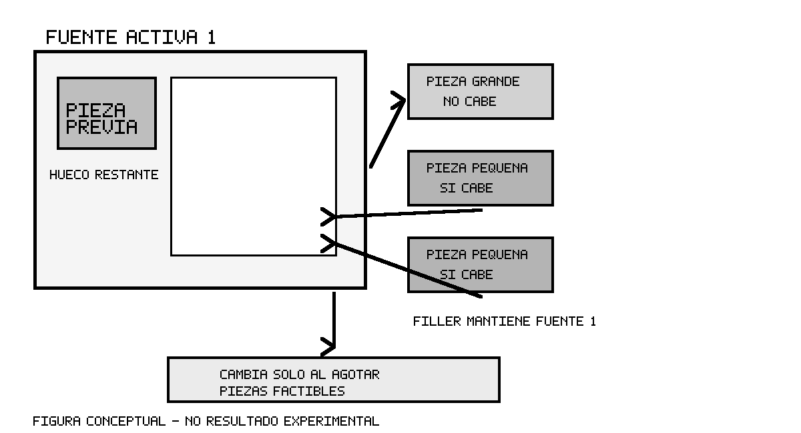

# SP-004 — Investigación de Filler (FL)

## 1. Contexto del problema

NewGlass ya compara tres políticas productivas para decidir a qué material asignar cada pieza. El comportamiento compartido prioriza retazos, rota piezas con el paso angular configurado y encuentra la primera posición factible en el raster. Este Spike estudia una política adicional de selección de piezas y progresión por fuente, sin registrarla en producción. La pregunta es si mantener una fuente activa y probar piezas pendientes menores tras un rechazo temporal encuentra colocaciones que las políticas existentes no buscan de la misma manera.

El problema combina asignación de piezas a múltiples fuentes y diseño geométrico de cada layout. La literatura separa esas decisiones: una heurística de selección decide pieza y objeto; otra rutina determina la posición geométrica. Filler pertenece a la primera decisión y no reemplaza el motor geométrico.

## 2. First Fit, Best Fit y Worst Fit actualmente

La tabla distingue definiciones usuales de los comportamientos observados en esta rama. “Objeto” corresponde a una unidad física de stock.

| Método | Definición académica usual | Comportamiento real de NewGlass |
|---|---|---|
| FF | Considera los objetos abiertos en orden y coloca la pieza en el primero donde cabe; el orden de piezas depende de la variante. | Recibe un `OptimizationProblem` inmutable. Agrupa y ordena por material y espesor; dentro de cada grupo `prepare_group_units` ordena área descendente, dimensión de bounding box descendente, pedido, pieza y unidad. Para cada unidad recorre retazos y luego planchas, cada una en el orden de inventario preservado. Por fuente, prueba orientaciones en orden angular; por orientación acepta la primera posición factible row-major. No compara calidad entre fuentes. Los empates quedan definidos por ese orden estable. Por tanto, esta FF actual ya ordena por área y no procesa la secuencia original como FF académica clásica. |
| BF | Para la pieza seleccionada, prefiere el objeto donde su colocación deja menor espacio libre. | Conserva exactamente el orden de piezas y la búsqueda geométrica de FF. Para cada fuente compara el candidato canónico de cada objeto factible y elige el de menor número de celdas libres después del placement. Desempata por rango de stock, orientación, fila y columna. Retazo es una categoría de prioridad: si algún retazo cabe, la comparación no continúa a planchas. No selecciona qué pieza sigue ni busca un mejor placement alternativo dentro del mismo objeto. |
| WF | Para la pieza seleccionada, prefiere el objeto con mayor espacio libre restante. | Usa la misma secuencia, candidatos canónicos y prioridades de FF. Cambia el selector para maximizar celdas libres después de colocar, con desempates estables por rango de stock, orientación, fila y columna. También evalúa retazos antes que planchas; una plancha no gana frente a un retazo factible aunque deje más espacio. |

El contrato común es `pack()` en `domain/packing.py`; FF pasa sin selector, BF/WF entregan una función de selección de candidatos factibles. `FeasibleCandidate` representa solo la primera combinación factible de orientación/posición de cada fuente física. `SheetLayout` aplica máscara raster, margen, separación y colisión. `RasterCache` y `PreparedRunGeometry` en `rotation.py` y `run_geometry.py` preparan contornos y materiales por corrida. Las métricas oficiales están en `domain/metrics.py`: aprovechamiento usa área real de piezas colocadas sobre área de materiales usados; merma descuenta área colocada y rectángulos recuperables encontrados sobre el raster. Stock se agrupa por `(glass_type_id, thickness_mm)`; la política compartida ordena retazos antes que planchas.

El loader congelado es `experiments/optimization/loader.py`. Reconstruye snapshots sin base de datos. Los casos son `EXP-SMALL-001` (3 unidades, un tipo de forma y un retazo más una plancha), `EXP-MEDIUM-001` (9 unidades heterogéneas en un grupo de material) y `EXP-COMPLEX-001` (24 unidades, cinco tipos de material/espesor y cinco fuentes físicas). Los fixtures forman parte de TA-027 y no se alteran en este Spike.

## 3. Filler

La literatura consultada caracteriza Filler como una heurística de selección: ordena las piezas por área decreciente, trabaja con un solo objeto abierto y coloca tantas piezas como pueda en ese objeto. Cuando ninguna pieza pendiente cabe allí, abre otro objeto y continúa. En consecuencia, una pieza prioritaria que falla no obliga por sí sola a abandonar el objeto: deben probarse las piezas pendientes restantes. La interpretación del Spike —permanecer mientras alguna pieza restante sea factible y avanzar solo cuando ninguna lo sea— es compatible con esa descripción.

Filler no define una coordenada ni una rotación. La colocación depende de la rutina geométrica emparejada con la política de selección. La literatura consultada no especifica los detalles del contrato NewGlass, el raster, la prioridad de retazo sobre plancha ni sus empates; esos elementos se conservan del motor local.

En este experimento el orden total es área descendente, ID de pieza ascendente, índice de unidad y pedido como desempates. Se activa una fuente física en el orden existente de retazos y luego planchas. En ella se prueba toda la lista pendiente ordenada hasta encontrar la primera pieza factible. Si encuentra una, la coloca y reinicia la búsqueda desde la pieza pendiente prioritaria; si no encuentra ninguna, activa la fuente siguiente. Si las fuentes se agotan, las unidades restantes quedan sin colocar.

## 4. Ejemplo conceptual

Considérese una fuente rectangular que ya contiene una pieza rectangular grande y deja un pasillo estrecho. La siguiente pieza pendiente es otro rectángulo grande y no cabe en el espacio residual. La lista incluye después un círculo pequeño y un triángulo convexo pequeño. Filler conserva la fuente activa, prueba el círculo con las rotaciones y posiciones del motor y, si cabe, lo coloca. Vuelve a recorrer las pendientes; si el triángulo también cabe, lo coloca en esa fuente. Solo cuando ninguna pieza pendiente cabe cambia a otro retazo o plancha. La figura adjunta es conceptual y no representa un resultado de benchmark.

## 5. Diferencia con First Fit

FF fija una pieza siguiente y busca la primera fuente compatible donde entre. Filler fija una fuente y busca entre las piezas pendientes la primera que pueda entrar en ella. La diferencia es el eje de la búsqueda: pieza→fuente para FF frente a fuente→pieza para Filler. En NewGlass, la política común actual además usa área descendente, por lo que esta versión concreta de Filler puede coincidir con FF en ciertos fixtures.

## 6. Diferencia con Best Fit

BF compara fuentes factibles para la pieza actual según las celdas libres que quedarían. Filler no compara fuentes abiertas por desperdicio: intenta agotar la fuente activa y permite que una pieza posterior pase delante temporalmente a una pieza que no cabe. No es un alias de BF.

## 7. Diferencia con Worst Fit

WF compara las fuentes factibles para la pieza actual y favorece la de mayor espacio libre posterior. Filler tampoco maximiza espacio residual: prioriza completar la fuente en uso con piezas pendientes factibles. La heurística puede, por ello, abrir las siguientes fuentes en un orden distinto.

## 8. Aporte potencial a NewGlass

Como hipótesis, la búsqueda de piezas pendientes menores puede ocupar huecos de la fuente activa, evitar que una pieza individual imposible fuerce una apertura prematura, aumentar el uso de retazos y resultar útil en pedidos heterogéneos. Estos efectos dependen de la geometría, el orden y el inventario. No se presuponen mejoras de unidades, aprovechamiento, merma o tiempo; se miden con los mismos fixtures.

## 9. Adaptación a geometrías NewGlass

La política observa únicamente si el motor informa un candidato factible. Rectángulos, círculos y polígonos convexos pasan por `prepare_run_geometry`, `RasterCache`, rotación discreta y `SheetLayout`. Las máscaras mantienen el contorno real rasterizado y no se aprueba una pieza solo porque su bounding box quepa. Filler no genera geometría, no estima colisiones y no elige posiciones propias.

## 10. Material y espesor

Solo se comparan unidades dentro de su grupo `(tipo de vidrio, espesor)`. Las validaciones y snapshots existentes garantizan compatibilidad; el experimento no cambia ni mezcla inventario.

## 11. Rotación, margen y separación

Se mantiene la resolución de 1 mm, paso angular de 5°, rotaciones actuales, margen y separación declarados por cada fixture. La secuencia angular, el rasterizado de piezas/materiales y la detección de solapamiento son los del motor. Ninguno se redefine para Filler.

## 12. Protocolo experimental

Se ejecutan SMALL, MEDIUM y COMPLEX originales con FF, BF, WF y Filler en secuencia, liberando referencias entre métodos. Se reutiliza `calculate_metrics`; no se recalculan fórmulas de aprovechamiento, merma ni área recuperable. Se registran unidades, fuentes consumidas, aprovechamiento, merma, área recuperable y duración. Para explicar Filler se registran intentos temporalmente omitidos, éxitos posteriores en la fuente activa, cambios de fuente y orden de piezas. Las corridas repetidas ×3 comparan placements y decisiones para comprobar determinismo; runtime se trata como diagnóstico y puede variar.

El código experimental vive en `experiments/optimization/filler/`. La progresión propia es necesaria porque el `pack()` productivo no permite exponer ni retener una fuente activa durante las búsquedas de piezas alternativas; no se modificó producción.

## 13. Referencias

1. López-Camacho, E., Ochoa, G., Terashima-Marín, H. y Burke, E. (2013). “An effective heuristic for the two-dimensional irregular bin packing problem.” *Annals of Operations Research*, 206, 241–264. La sección de heurísticas de selección describe Filler como orden decreciente de área y empaquetado de tantas piezas como sea posible en un objeto antes de abrir el siguiente. [Registro institucional y DOI](https://dspace.stir.ac.uk/handle/1893/16444).
2. Sosa-Ascencio, A., Terashima-Marín, H., Ortiz-Bayliss, J. C. y Conant-Pablos, S. E. (2016). “Grammar-based Selection Hyper-heuristics for Solving Irregular Bin Packing Problems.” *GECCO ’16 Companion*. Identifica Filler como heurística de selección, separada de la heurística de colocación, para piezas irregulares. [Artículo de conferencia](https://www.jcobayliss.net/papers/GECCO2016b.pdf).
3. Bennell, J. A. y Oliveira, J. F. (2008). “The geometry of nesting problems: A tutorial.” *European Journal of Operational Research*, 184(2), 397–415. [DOI: 10.1016/j.ejor.2006.11.038](https://doi.org/10.1016/j.ejor.2006.11.038).
